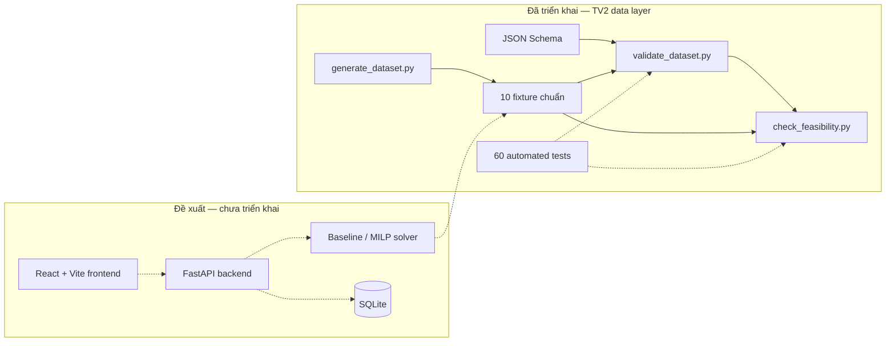
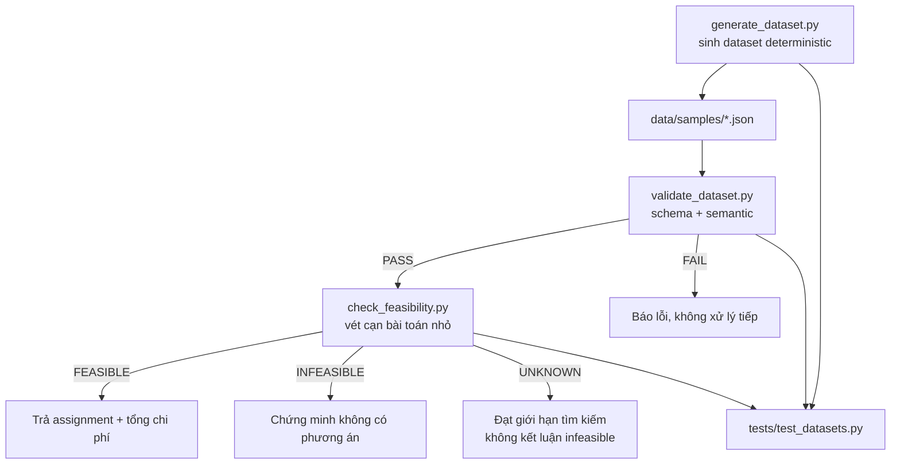

# LogiMind

LogiMind là dự án học thuật xây dựng hệ thống hỗ trợ ra quyết định cho **bài toán phân bổ đơn hàng giữa nhiều kho** (Multi-Warehouse Order Allocation Problem — MWOAP). Hệ thống nhận danh sách đơn hàng, tồn kho theo từng SKU, năng lực xử lý của từng kho và chi phí vận chuyển, sau đó tìm phương án gán mỗi đơn hàng cho đúng một kho với tổng chi phí vận chuyển nhỏ nhất.

Dự án đang ở giai đoạn **xây dựng nền tảng dữ liệu và đặc tả hệ thống**. Phần dữ liệu Policy A của TV2 đã được triển khai và kiểm thử; solver tối ưu, backend API, cơ sở dữ liệu SQLite và frontend vẫn là các thành phần đề xuất, chưa có mã nguồn triển khai.

> **Chính sách phân bổ hiện hành: Policy A — Strict Non-Split Allocation.**
>
> Mỗi đơn hàng được giao đầy đủ từ đúng một kho. Không cho phép chia đơn (split shipment), không cho phép đơn chưa được phân bổ, không có penalty cho chia đơn hoặc đơn chưa phân bổ. Quyết định được ghi tại [ADR-004](docs/decisions/0004-allocation-policy-a.md).

---

## Mục lục

1. [Giới thiệu dự án](#1-giới-thiệu-dự-án)
2. [Tổng quan nghiệp vụ](#2-tổng-quan-nghiệp-vụ)
3. [Mục tiêu và phạm vi](#3-mục-tiêu-và-phạm-vi)
4. [Tính năng chính](#4-tính-năng-chính)
5. [Kiến trúc hệ thống](#5-kiến-trúc-hệ-thống)
6. [Nguyên lý hoạt động](#6-nguyên-lý-hoạt-động)
7. [Mô hình tối ưu hóa](#7-mô-hình-tối-ưu-hóa)
8. [Công nghệ sử dụng](#8-công-nghệ-sử-dụng)
9. [Cấu trúc thư mục](#9-cấu-trúc-thư-mục)
10. [Yêu cầu hệ thống](#10-yêu-cầu-hệ-thống)
11. [Cài đặt và cấu hình](#11-cài-đặt-và-cấu-hình)
12. [Chạy dự án](#12-chạy-dự-án)
13. [Kiểm thử](#13-kiểm-thử)
14. [Kết quả và đánh giá](#14-kết-quả-và-đánh-giá)
15. [Thành viên và phân công](#15-thành-viên-và-phân-công)
16. [Trạng thái phát triển và Roadmap](#16-trạng-thái-phát-triển-và-roadmap)
17. [Đóng góp](#17-đóng-góp)
18. [Tài liệu tham khảo](#18-tài-liệu-tham-khảo)
19. [Giấy phép](#19-giấy-phép)

---

## 1. Giới thiệu dự án

### 1.1. Bối cảnh

Các doanh nghiệp thương mại điện tử thường vận hành nhiều kho fulfillment để rút ngắn khoảng cách giao hàng. Tuy nhiên, khi có nhiều kho, việc chọn kho cho từng đơn không còn đơn giản:

- Một đơn có nhiều SKU có thể không đủ hàng tại kho gần nhất.
- Kho gần nhất có thể hết năng lực xử lý dù vẫn còn hàng.
- Chi phí vận chuyển khác nhau giữa các cặp đơn hàng — kho.
- Chọn kho rẻ nhất cho từng đơn một cách độc lập có thể làm cạn tồn kho hoặc công suất, khiến các đơn sau phải dùng kho đắt hơn.

LogiMind giải quyết bài toán này bằng cách xét đồng thời toàn bộ đơn hàng, tồn kho theo SKU và năng lực xử lý theo số đơn của từng kho.

### 1.2. Mục tiêu

- Mô hình hóa bài toán phân bổ đơn hàng nhiều kho dưới dạng bài toán tối ưu.
- Cung cấp bộ dữ liệu chuẩn, có thể tái lập, phục vụ kiểm thử và so sánh thuật toán.
- So sánh một heuristic baseline với nghiệm tối ưu MILP trên cùng dữ liệu.
- Cung cấp nền tảng cho API, cơ sở dữ liệu và giao diện quản trị trong các giai đoạn tiếp theo.

### 1.3. Chính sách phân bổ hiện hành

Theo **Policy A**:

1. Mỗi đơn hàng phải được giao đầy đủ.
2. Mỗi đơn hàng chỉ được gán cho đúng một kho.
3. Không cho phép split shipment.
4. Không cho phép đơn hàng không được phân bổ.
5. Không có split penalty, unassigned penalty hoặc handling cost trong bài toán.
6. Năng lực kho được tính bằng **số đơn hàng**, không phải số sản phẩm.
7. Tồn kho được quản lý riêng theo từng SKU tại từng kho.
8. Mục tiêu là tối thiểu hóa tổng chi phí vận chuyển.
9. Dataset hợp lệ về cấu trúc không đồng nghĩa với bài toán có nghiệm.
10. Chỉ kết luận `INFEASIBLE` khi có bằng chứng chứng minh không tồn tại phương án đầy đủ.

---

## 2. Tổng quan nghiệp vụ

### 2.1. Các khái niệm chính

| Khái niệm | Ý nghĩa | Trường dữ liệu tiêu biểu |
| :--- | :--- | :--- |
| **Đơn hàng (Order)** | Yêu cầu giao một tập SKU với số lượng xác định. | `order_id`, `items`, `shipping_costs` |
| **Kho (Warehouse)** | Địa điểm fulfillment có tồn kho và năng lực xử lý. | `warehouse_id`, `capacity_orders`, `inventory` |
| **SKU** | Một loại sản phẩm cụ thể. | `sku_id`, `name` |
| **Tồn kho (Inventory)** | Số lượng khả dụng của từng SKU tại từng kho. | `inventory` dạng `{sku_id: số nguyên ≥ 0}` |
| **Năng lực xử lý (Capacity)** | Số đơn tối đa kho có thể xử lý trong một đợt. | `capacity_orders` |
| **Chi phí vận chuyển** | Chi phí giao toàn bộ một đơn từ một kho. | `shipping_costs` dạng `{warehouse_id: số thực ≥ 0}` |
| **Phân bổ (Allocation)** | Gán mỗi đơn cho đúng một kho và tính tổng chi phí. | Kết quả `order_id → warehouse_id` |

### 2.2. Ví dụ nghiệp vụ

Xét dataset mẫu [`data/samples/sample_small.json`](data/samples/sample_small.json):

- Hai kho: `WH-01` và `WH-02`, mỗi kho có `capacity_orders = 2`.
- Hai SKU: `SKU-A`, `SKU-B`.
- Ba đơn hàng:
  - `ORD-001`: 2 × `SKU-A`, 1 × `SKU-B`.
  - `ORD-002`: 3 × `SKU-A`.
  - `ORD-003`: 4 × `SKU-B`.

Một phương án hợp lệ đã được kiểm chứng bằng feasibility checker:

| Đơn hàng | Kho được gán | Chi phí vận chuyển |
| :--- | :--- | ---: |
| `ORD-001` | `WH-01` | 4.0 |
| `ORD-002` | `WH-01` | 5.0 |
| `ORD-003` | `WH-02` | 3.0 |
| **Tổng** | | **12.0** |

Phương án này thỏa mãn:

- Mỗi đơn đúng một kho.
- `WH-01` nhận 2 đơn, không vượt `capacity_orders = 2`.
- `WH-02` nhận 1 đơn, không vượt `capacity_orders = 2`.
- Tồn kho từng SKU tại từng kho không bị vượt.

> Đây là một phương án **hợp lệ và đã được kiểm chứng**, không phải tuyên bố tối ưu toàn cục. Việc chứng minh tối ưu thuộc phạm vi solver MILP của TV3.

### 2.3. Split shipment và phạm vi hiện tại

**Split shipment** là việc giao một đơn hàng từ hai hoặc nhiều kho. Cách làm này có thể tăng chi phí đóng gói, xử lý và giao hàng, đồng thời làm trải nghiệm khách hàng phức tạp hơn.

Trong **Policy A hiện hành**, split shipment **không được phép**. Một đơn chỉ được gán cho một kho và kho đó phải có đủ toàn bộ số lượng của mọi SKU trong đơn. Không có split penalty hoặc unassigned penalty trong mô hình hiện tại.

Các tài liệu cũ có nhắc đến Policy B (cho phép chia đơn hoặc bỏ đơn với penalty) chỉ được giữ làm tham chiếu lịch sử; chúng không phải chính sách đang áp dụng.

---

## 3. Mục tiêu và phạm vi

### 3.1. Đã triển khai

- JSON Schema chuẩn cho dataset Policy A.
- Bộ 10 fixture chuẩn: small, medium, large, infeasible và 6 edge case.
- Validator kiểm tra schema và các ràng buộc ngữ nghĩa.
- Generator tạo dataset deterministic, đảm bảo feasible theo cách dựng.
- Feasibility checker vét cạn cho bài toán nhỏ.
- Bộ 60 automated tests cho data layer.
- CI gồm repository hygiene và job TV2 dataset/feasibility.
- Tài liệu Policy A: data dictionary, API contract, architecture, testing strategy, README.

### 3.2. Đang thực hiện

- Căn chỉnh và rà soát tính nhất quán giữa tài liệu nghiệp vụ, API contract và data contract.
- Chờ team xác nhận/ratify Policy A và tiếp nhận schema bởi các module TV3/TV4/TV5/TV6.

### 3.3. Chưa triển khai

- Solver baseline và MILP.
- FastAPI backend.
- SQLite schema/migrations và persistence.
- React + Vite frontend.
- Integration tests, API contract tests và E2E tests.
- Benchmark so sánh baseline với MILP.

### 3.4. Dự kiến phát triển

- Solver adapter theo Policy A.
- API chạy allocation và trả kết quả theo [API contract](docs/api-contract.md).
- Giao diện xem dataset, chạy phân bổ và xem utilization.
- Báo cáo benchmark và demo cuối kỳ.

---

## 4. Tính năng chính

Chỉ các tính năng dưới đây có bằng chứng trong repository:

| Tính năng | Trạng thái | Bằng chứng |
| :--- | :--- | :--- |
| Canonical dataset schema (JSON Schema Draft 2020-12) | Đã triển khai | [`data/schema/dataset.schema.json`](data/schema/dataset.schema.json) |
| 10 fixture chuẩn Policy A | Đã triển khai | [`data/samples/`](data/samples/) |
| Validator schema + semantic | Đã triển khai | [`scripts/validate_dataset.py`](scripts/validate_dataset.py) |
| Generator deterministic, feasible by construction | Đã triển khai | [`scripts/generate_dataset.py`](scripts/generate_dataset.py) |
| Feasibility checker vét cạn | Đã triển khai | [`scripts/check_feasibility.py`](scripts/check_feasibility.py) |
| 60 automated tests | Đã triển khai | [`tests/test_datasets.py`](tests/test_datasets.py) |
| CI hygiene + TV2 dataset/feasibility job | Đã triển khai | [`.github/workflows/ci.yml`](.github/workflows/ci.yml) |
| Policy A API contract | Đã đặc tả, chưa có implementation | [`docs/api-contract.md`](docs/api-contract.md) |
| Legacy nearest-warehouse prototype | Có, nhưng **không phải Policy A** | [`scripts/validate_orders.py`](scripts/validate_orders.py) |
| Baseline/MILP solver | Chưa triển khai | Không có code trong `src/` |
| Backend API, SQLite, frontend | Chưa triển khai | Không có code/package tương ứng |

---

## 5. Kiến trúc hệ thống

### 5.1. Sơ đồ tổng thể



**Ghi chú:** các nét đứt là thành phần đề xuất, chưa có implementation. Chỉ data layer TV2 và legacy prototype là chạy được.

### 5.2. Vai trò các thành phần

| Thành phần | Vai trò | Trạng thái |
| :--- | :--- | :--- |
| **Data module (TV2)** | Schema, fixture, validator, generator, feasibility checker | Đã triển khai |
| **Optimization engine (TV3)** | Baseline heuristic, MILP, solver adapter | Chưa triển khai |
| **Backend API (TV5)** | FastAPI, validation, điều phối solver, persistence | Chưa triển khai |
| **Database (TV5)** | SQLite lưu dataset/run/allocation | Chưa triển khai |
| **Frontend (TV4)** | React + Vite, hiển thị kết quả và utilization | Chưa triển khai |
| **Testing & Integration (TV6)** | Contract, integration, E2E, benchmark report | Mới có TV2 test suite |

Chi tiết kiến trúc đề xuất: [`docs/architecture.md`](docs/architecture.md).

---

## 6. Nguyên lý hoạt động

### 6.1. Luồng dữ liệu đã triển khai



### 6.2. Luồng API đề xuất (chưa triển khai)

1. Client gửi `dataset_id` hoặc dataset inline đến `POST /api/v1/allocations/run`.
2. Backend validate dataset theo canonical schema.
3. Nếu dataset không hợp lệ: trả `400 VALIDATION_ERROR`.
4. Nếu hợp lệ: gọi solver.
5. Solver trả một trong các trạng thái `OPTIMAL`, `FEASIBLE`, `INFEASIBLE`, `NO_SOLUTION_FOUND`, `ERROR`.
6. Backend trả allocation (mỗi đơn đúng một kho), utilization theo số đơn và tổng shipping cost.

Đặc tả chi tiết: [`docs/api-contract.md`](docs/api-contract.md).

---

## 7. Mô hình tối ưu hóa

Mô hình hiện hành là **Policy A**. Ký hiệu:

- $I$: tập đơn hàng.
- $J$: tập kho.
- $K$: tập SKU.
- $q_{ik}$: số lượng SKU $k$ đơn $i$ cần.
- $s_{jk}$: tồn kho SKU $k$ tại kho $j$.
- $C_j$: số đơn tối đa kho $j$ xử lý (`capacity_orders`).
- $c_{ij}$: chi phí giao toàn bộ đơn $i$ từ kho $j$.
- $x_{ij} \in \{0,1\}$: bằng 1 nếu đơn $i$ được gán cho kho $j$.

**Hàm mục tiêu:**

$$
\min \sum_{i \in I}\sum_{j \in J} c_{ij} x_{ij}
$$

**Các ràng buộc:**

1. Mỗi đơn đúng một kho:
   $$
   \sum_{j \in J} x_{ij} = 1 \quad \forall i \in I
   $$
2. Không vượt tồn kho từng SKU:
   $$
   \sum_{i \in I} q_{ik} x_{ij} \le s_{jk} \quad \forall j \in J,\ k \in K
   $$
3. Không vượt năng lực xử lý theo số đơn:
   $$
   \sum_{i \in I} x_{ij} \le C_j \quad \forall j \in J
   $$
4. Tuyến không khả dụng:
   $$
   x_{ij} = 0 \quad \text{nếu kho } j \text{ không có trong } shipping\_costs \text{ của đơn } i
   $$

Không có biến đơn chưa phân bổ, không có split penalty, không có unassigned penalty và không có handling cost. Nếu không tồn tại phương án thỏa mãn tất cả ràng buộc, bài toán **infeasible**; dataset vẫn có thể hợp lệ về cấu trúc.

Mô hình đầy đủ và ví dụ: [`docs/mathematical-model.md`](docs/mathematical-model.md).

---

## 8. Công nghệ sử dụng

| Thành phần | Công nghệ | Vai trò | Trạng thái |
| :--- | :--- | :--- | :--- |
| Ngôn ngữ | Python `>= 3.10` | Data tooling, legacy prototype, test | Đã dùng |
| Schema | JSON Schema Draft 2020-12 | Đặc tả dataset Policy A | Đã dùng |
| Validation | `jsonschema>=4.18` | Validator, generator, checker | Đã dùng |
| Testing | `unittest` (chuẩn), `pytest>=7` (tùy chọn) | 60 tests | Đã dùng |
| Lint | `ruff>=0.1` (dev extra) | Kiểm tra code style | Đã cấu hình |
| CI/CD | GitHub Actions | Hygiene + TV2 dataset/feasibility | Đã dùng |
| Backend | FastAPI | REST API đề xuất | Chưa triển khai |
| Database | SQLite | Persistence đề xuất | Chưa triển khai |
| Frontend | React + Vite | Giao diện đề xuất | Chưa triển khai |
| Optimization | PuLP/CBC hoặc OR-Tools | MILP đề xuất (ADR-001) | Chưa triển khai |

Các lựa chọn backend/database/solver vẫn ở trạng thái **đề xuất** trong ADR-001/002/003; chỉ ADR-004 (Policy A) là đã được chấp nhận.

---

## 9. Cấu trúc thư mục

```text
LogiMind/
├── .github/
│   ├── ISSUE_TEMPLATE/
│   │   ├── bug_report.md
│   │   ├── feature_request.md
│   │   └── task.md
│   ├── workflows/ci.yml
│   └── pull_request_template.md
├── data/
│   ├── README.md
│   ├── legacy/benchmark_data.json
│   ├── samples/
│   │   ├── sample_small.json
│   │   ├── sample_medium.json
│   │   ├── sample_large.json
│   │   ├── sample_infeasible.json
│   │   ├── edge_tight_capacity.json
│   │   ├── edge_tight_inventory.json
│   │   ├── edge_equal_costs.json
│   │   ├── edge_zero_stock.json
│   │   ├── edge_unavailable_route.json
│   │   └── edge_infeasible_stock.json
│   └── schema/dataset.schema.json
├── docs/
│   ├── decisions/
│   │   ├── 0001-choice-of-optimization-solver-library.md
│   │   ├── 0002-choice-of-backend-framework.md
│   │   ├── 0003-choice-of-database-engine.md
│   │   ├── 0004-allocation-policy-a.md
│   │   └── README.md
│   ├── project-management/
│   │   ├── integration-plan.md
│   │   ├── project-status.md
│   │   ├── repository-cleanup-plan.md
│   │   ├── task-tracker.md
│   │   └── test-plan.md
│   ├── reference/project-analysis.docx
│   ├── api-contract.md
│   ├── architecture.md
│   ├── data-dictionary.md
│   ├── git-workflow.md
│   ├── glossary.md
│   ├── index.md
│   ├── integration-guide.md
│   ├── mathematical-model.md
│   ├── project-overview.md
│   ├── requirements.md
│   ├── team-responsibilities.md
│   └── testing-strategy.md
├── scripts/
│   ├── README.md
│   ├── check_feasibility.py
│   ├── generate_dataset.py
│   ├── validate_dataset.py
│   └── validate_orders.py
├── src/README.md
├── tests/
│   ├── README.md
│   └── test_datasets.py
├── .editorconfig
├── .env.example
├── .gitattributes
├── .gitignore
├── CHANGELOG.md
├── CLAUDE.md
├── CONTRIBUTING.md
├── README.md
└── pyproject.toml
```

Các thư mục `src/logimind/`, `frontend/` và `tests/unit|integration|e2e/` **chưa tồn tại** vì chưa có implementation tương ứng. Vị trí dự kiến được ghi trong [`src/README.md`](src/README.md) và [`tests/README.md`](tests/README.md).

---

## 10. Yêu cầu hệ thống

### 10.1. Bắt buộc

- **Python 3.10 trở lên** (`pyproject.toml` yêu cầu `>=3.10`; CI dùng Python 3.10).
- **Git**.
- **`jsonschema>=4.18`** cho validator, generator và feasibility checker.
- Không cần database, Node.js hay solver bên ngoài cho các thành phần hiện có.

### 10.2. Tùy chọn

- `pytest>=7` nếu muốn chạy bằng pytest.
- `ruff>=0.1` nếu muốn lint.
- Có thể cài tất cả qua extra `dev`.

### 10.3. Môi trường đã xác minh

- CI: Ubuntu, Python 3.10.
- Kiểm thử cục bộ trong quá trình phát triển: Linux, Python 3.15.
- Windows/macOS chưa được xác minh trong repository.

---

## 11. Cài đặt và cấu hình

### 11.1. Clone repository

```bash
git clone https://github.com/NTbankey1/LogiMind.git
cd LogiMind
```

### 11.2. Tạo môi trường ảo

```bash
python3 --version          # yêu cầu >= 3.10
python3 -m venv .venv
source .venv/bin/activate  # Windows: .venv\Scripts\activate
```

### 11.3. Cài dependencies

```bash
# Cài đầy đủ dev extra (jsonschema, pytest, ruff)
pip install -e ".[dev]"

# Hoặc chỉ cài tối thiểu để chạy TV2 tools/tests
pip install jsonschema pytest
```

Legacy prototype `scripts/validate_orders.py` chỉ dùng thư viện chuẩn; không cần cài thêm.

### 11.4. Cấu hình môi trường

Hiện tại các script/data layer **không đọc biến môi trường**. File [`.env.example`](.env.example) chỉ chứa cấu hình đề xuất cho backend/solver trong tương lai:

- `PORT`, `HOST` — backend đề xuất.
- `DATABASE_URL` — SQLite đề xuất.
- `SOLVER_TIMEOUT_SECONDS`, `SOLVER_NAME` — solver đề xuất.

Không cần tạo `.env` để chạy các thành phần hiện có. Không commit `.env` thật.

### 11.5. Database và dữ liệu

- Không cần khởi tạo database; SQLite chưa được triển khai.
- Dữ liệu mẫu đã có sẵn trong `data/samples/` và `data/legacy/`.
- Không cần tải dữ liệu từ dịch vụ ngoài.

---

## 12. Chạy dự án

Tất cả lệnh dưới đây chạy từ thư mục gốc repository.

### 12.1. Validate toàn bộ fixture Policy A

```bash
python scripts/validate_dataset.py data/samples/
```

Kết quả mong đợi: 10 dòng `[PASS]`, `10 datasets validated.`, `0 validation errors.`, exit code `0`.

### 12.2. Kiểm tra feasibility cho bài toán nhỏ

```bash
python scripts/check_feasibility.py data/samples/sample_small.json
python scripts/check_feasibility.py data/samples/sample_infeasible.json
python scripts/check_feasibility.py data/samples/edge_infeasible_stock.json
python scripts/check_feasibility.py data/samples/sample_small.json --json
```

Status có thể là `FEASIBLE`, `INFEASIBLE`, `UNKNOWN`, `INVALID`. Exit code: `0` cho `FEASIBLE`/`INFEASIBLE`, `1` cho `INVALID`, `2` cho `UNKNOWN`.

### 12.3. Sinh dataset mới

```bash
python scripts/generate_dataset.py \
  --warehouses 4 \
  --orders 20 \
  --skus 5 \
  --seed 20261111 \
  --output data/samples/generated.json
```

Generator tạo dataset feasible theo cách dựng. Cùng tham số và seed tạo JSON giống nhau trên cùng phiên bản Python. File `generated.json` chỉ nên commit sau khi được review thành fixture chính thức.

### 12.4. Chạy legacy prototype

```bash
python scripts/validate_orders.py
```

Script đọc `data/legacy/benchmark_data.json`, tính khoảng cách Euclidean và gán đơn cho kho gần nhất còn đủ năng lực. Đây là prototype minh họa, **không phải Policy A** và không phải solver tối ưu.

### 12.5. Chạy backend/frontend

**Chưa thể chạy** vì chưa có implementation:

- Backend FastAPI: chưa có `src/logimind/backend/`.
- Frontend React: chưa có `frontend/`.
- SQLite: chưa có schema/migrations.

API contract trong [`docs/api-contract.md`](docs/api-contract.md) là đặc tả để TV5 triển khai, không phải server đang chạy.

### 12.6. Kiểm tra cú pháp JSON

```bash
python -m json.tool data/samples/sample_small.json > /dev/null
python -m json.tool data/legacy/benchmark_data.json > /dev/null
```

---

## 13. Kiểm thử

### 13.1. Bộ test hiện có

- File: [`tests/test_datasets.py`](tests/test_datasets.py).
- Số lượng: **60 tests**.
- Công cụ: `unittest` (chuẩn), tương thích `pytest`.
- Phạm vi:
  - Schema và semantic validation.
  - Duplicate ID, unknown field, inventory thiếu, stock/capacity/cost âm.
  - `NaN`/`Infinity`, boolean trong trường số.
  - Policy B fields bị reject.
  - Generator deterministic và feasible.
  - Feasibility statuses cho toàn bộ fixture.
  - Search limit trả `UNKNOWN`, không trả `INFEASIBLE`.
  - Không mutate input; assignment thỏa stock/capacity/route/cost.

### 13.2. Chạy test

```bash
# unittest (CI dùng lệnh này)
python -m unittest discover -s tests -v

# pytest (tùy chọn)
python -m pytest tests/ -v
```

### 13.3. Trạng thái kiểm thử thực tế

Đã chạy trong quá trình phát triển:

```text
python -m unittest discover -s tests
Ran 60 tests ... OK

python -m pytest tests/ -q
60 passed
```

### 13.4. Chưa có test cho

- Baseline/MILP solver (TV3).
- FastAPI/API contract (TV5).
- SQLite persistence (TV5).
- Frontend/E2E (TV4/TV6).
- Benchmark so sánh baseline và MILP.

Không có tuyên bố các phần này đã được kiểm thử.

---

## 14. Kết quả và đánh giá

### 14.1. Kết quả đã xác minh

10 fixture chuẩn đã được validate và kiểm tra feasibility:

| Fixture | Kích thước (kho / đơn / SKU) | Trạng thái |
| :--- | :--- | :--- |
| `sample_small.json` | 2 / 3 / 2 | `FEASIBLE` |
| `sample_medium.json` | 4 / 20 / 5 | `FEASIBLE` |
| `sample_large.json` | 8 / 60 / 10 | `FEASIBLE` |
| `sample_infeasible.json` | 2 / 3 / 1 | `INFEASIBLE` (thiếu capacity) |
| `edge_tight_capacity.json` | 2 / 3 / 1 | `FEASIBLE` |
| `edge_tight_inventory.json` | 2 / 2 / 2 | `FEASIBLE` |
| `edge_equal_costs.json` | 2 / 2 / 1 | `FEASIBLE` |
| `edge_zero_stock.json` | 2 / 2 / 2 | `FEASIBLE` |
| `edge_unavailable_route.json` | 2 / 2 / 1 | `FEASIBLE` |
| `edge_infeasible_stock.json` | 2 / 1 / 1 | `INFEASIBLE` (thiếu stock) |

Validator: **10 datasets validated, 0 validation errors**.

Test suite: **60 tests pass**.

### 14.2. Chưa có kết quả benchmark

Repository **chưa có** kết quả so sánh baseline và MILP, thời gian chạy solver, mức giảm chi phí hay benchmark trên dữ liệu lớn. Các số liệu đó chỉ được ghi khi TV3/TV6 thực sự chạy và cung cấp bằng chứng.

Ví dụ allocation `12.0` ở mục 2.2 là một phương án hợp lệ đã kiểm chứng, không phải kết quả benchmark hay chứng minh tối ưu.

---

## 15. Thành viên và phân công

Theo [`docs/team-responsibilities.md`](docs/team-responsibilities.md), dự án có 6 vai trò chức năng:

| Vai trò | Phạm vi | Trạng thái trong repository |
| :--- | :--- | :--- |
| **TV1** | Phân tích nghiệp vụ và mô hình toán | Policy A model và requirements đã có |
| **TV2** | Dữ liệu và test dataset | Schema, fixture, generator, validator, checker, 60 tests |
| **TV3** | Thuật toán tối ưu | Chưa triển khai |
| **TV4** | Frontend | Chưa triển khai |
| **TV5** | Backend và database | Chưa triển khai |
| **TV6** | Tích hợp, kiểm thử, báo cáo | Có TV2 test suite và CI; integration/E2E chưa có |

Tên thành viên, GitHub handle và deadline hiện là `TBD` trong tài liệu chính thức; README không tự gán tên hoặc tài khoản.

---

## 16. Trạng thái phát triển và Roadmap

### 16.1. Đã hoàn thành

- Canonical Policy A data contract và data dictionary.
- 10 fixture chuẩn (4 fixture kích thước + 6 edge case).
- Validator, generator, feasibility checker.
- 60 automated tests.
- CI hygiene + TV2 dataset/feasibility job.
- ADR-004 và tài liệu Policy A.

### 16.2. Đang thực hiện

- Rà soát/ratify Policy A ở cấp team.
- Đồng bộ API contract, architecture và testing strategy với Policy A.
- Chuẩn bị bàn giao schema cho TV3/TV5/TV6.

### 16.3. Chưa triển khai

- Baseline heuristic và MILP solver.
- FastAPI backend.
- SQLite schema, migrations, persistence.
- React + Vite frontend.
- API contract tests, integration tests, E2E tests.
- Benchmark report và demo cuối kỳ.

### 16.4. Dự kiến

- TV3 triển khai solver theo Policy A.
- TV5 triển khai API theo [`docs/api-contract.md`](docs/api-contract.md).
- TV4 hiển thị một kho cho mỗi đơn và utilization theo số đơn.
- TV6 bổ sung contract/integration/E2E tests và benchmark report.

---

## 17. Đóng góp

Quy trình đầy đủ nằm trong [`CONTRIBUTING.md`](CONTRIBUTING.md). Tóm tắt:

1. Tạo branch theo mẫu `<type>/<short-description>` (`feat/`, `fix/`, `docs/`, `test/`, `refactor/`, `chore/`).
2. Không push trực tiếp vào `main`; mọi thay đổi đi qua Pull Request.
3. Commit theo Conventional Commits.
4. Chạy các kiểm tra liên quan trước khi mở PR:

   ```bash
   python scripts/validate_dataset.py data/samples/
   python -m unittest discover -s tests -v
   python -m json.tool data/samples/sample_small.json > /dev/null
   python -m json.tool data/legacy/benchmark_data.json > /dev/null
   ```

5. Ghi rõ phần đã kiểm tra và phần chưa kiểm tra trong PR.
6. Không commit `.env`, database, cache, build artifact hoặc dữ liệu lớn.

Nếu chưa có test cho module đang sửa, hãy nêu rõ thay vì tuyên bố đã kiểm thử.

---

## 18. Tài liệu tham khảo

| Tài liệu | Nội dung |
| :--- | :--- |
| [docs/index.md](docs/index.md) | Trung tâm tài liệu và lộ trình đọc theo vai trò |
| [docs/glossary.md](docs/glossary.md) | Thuật ngữ Việt–Anh dùng thống nhất |
| [docs/project-overview.md](docs/project-overview.md) | Bối cảnh, mục tiêu, phạm vi dự án |
| [docs/requirements.md](docs/requirements.md) | Yêu cầu nghiệp vụ và tiêu chí nghiệm thu |
| [docs/mathematical-model.md](docs/mathematical-model.md) | Mô hình Policy A, ràng buộc và ví dụ |
| [docs/data-dictionary.md](docs/data-dictionary.md) | Canonical data contract và legacy appendix |
| [docs/api-contract.md](docs/api-contract.md) | Hợp đồng API Policy A và trạng thái solver |
| [docs/architecture.md](docs/architecture.md) | Kiến trúc thành phần và luồng dữ liệu |
| [docs/integration-guide.md](docs/integration-guide.md) | Checklist bàn giao giữa các module |
| [docs/testing-strategy.md](docs/testing-strategy.md) | Chiến lược test, invariant và edge case |
| [docs/team-responsibilities.md](docs/team-responsibilities.md) | Vai trò TV1–TV6 |
| [docs/decisions/README.md](docs/decisions/README.md) | Chỉ mục ADR và trạng thái quyết định |
| [docs/decisions/0004-allocation-policy-a.md](docs/decisions/0004-allocation-policy-a.md) | Quyết định chọn Policy A |
| [docs/project-management/project-status.md](docs/project-management/project-status.md) | Trạng thái dự án và blocker |
| [data/README.md](data/README.md) | Danh mục fixture và lệnh dữ liệu |
| [scripts/README.md](scripts/README.md) | Hướng dẫn validator/generator/checker/prototype |
| [tests/README.md](tests/README.md) | Hướng dẫn chạy và mở rộng test |
| [CONTRIBUTING.md](CONTRIBUTING.md) | Quy trình branch, commit, PR và review |

---

## 19. Giấy phép

Repository hiện **chưa có file `LICENSE`** và chưa công bố điều khoản cấp phép. README không tự chọn hoặc áp đặt một giấy phép. Khi nhóm quyết định giấy phép, cần thêm file `LICENSE` tương ứng và cập nhật mục này.
