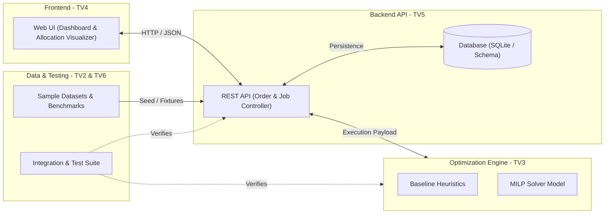

# LogiMind

> Multi-Warehouse Order Allocation & Fulfillment Optimization System.

LogiMind is an intelligent multi-warehouse order fulfillment optimization system designed to balance fulfillment costs, warehouse processing limits, and inventory availability across regional logistics networks.

---

## 1. Project Overview

In omni-channel retail and distributed e-commerce logistics, fulfilling customer orders across geographically distributed fulfillment centers (warehouses) is a multi-dimensional optimization problem. Sub-optimal order routing causes excessive split shipments, inflated last-mile delivery expenses, and localized processing bottlenecks.

LogiMind aims to formulate, solve, and visualize this order allocation challenge by combining Mixed-Integer Linear Programming (MILP) techniques, intuitive baseline heuristics, and an interactive decision-support interface.

---

## 2. Problem Statement

Given:
- A set of customer orders placed at various geographic destinations, each demanding specific quantities of Stock Keeping Units (SKUs).
- A network of warehouses, each holding finite inventory levels for each SKU, subject to daily throughput/processing capacities.
- A shipping cost matrix (distance, carrier rates, zone surcharges) and per-order processing costs.

Determine:
- The optimal allocation of orders (or order line-items) to fulfillment warehouses such that:
  1. Customer demand is fulfilled accurately.
  2. Inventory and warehouse capacity constraints are strictly respected.
  3. Total fulfillment cost (shipping + warehouse handling + split-shipment penalties) is minimized.

---

## 3. Objectives & Scope

### In-Scope (Phase 1 - Academic Prototype)
- Mathematical modeling of multi-warehouse order assignment using Mixed-Integer Linear Programming (MILP).
- Implementation of standard baseline heuristic algorithms (e.g., Nearest Warehouse, Greedy Single-Warehouse First) to benchmark optimization gain.
- Synthetic and realistic benchmark datasets (warehouses, SKUs, customer order profiles).
- Web-based user interface to input order batches, trigger solver runs, inspect allocation plans, and review cost trade-offs.
- API service connecting the UI, optimization engine, and persistence layer.

### Out-of-Scope (Future Enhancements)
- Real-time vehicle routing and dynamic GPS fleet tracking.
- Multi-echelon inventory replenishment forecasting.
- Live carrier API rate negotiation.

---

## 4. Key Constraints

The core mathematical model enforces:
- **Inventory Balance:** Total quantity of SKU $k$ dispatched from warehouse $w$ cannot exceed available stock $I_{w, k}$.
- **Warehouse Throughput:** Total volume or number of orders assigned to warehouse $w$ within a fulfillment window cannot exceed its daily processing capacity $C_w$.
- **Demand Satisfaction:** Every approved order line item must be fulfilled completely, or flagged through an explicit unassigned-order policy if global capacity is insufficient.
- **Split Shipment Policy:** Minimize or penalize splitting a single customer order across multiple dispatch centers to maintain customer satisfaction and avoid duplicate packaging costs.

Detailed formulation is documented in [docs/mathematical-model.md](docs/mathematical-model.md).

---

## 5. Planned System Architecture



See [docs/architecture.md](docs/architecture.md) for full architectural specifications.

---

## 6. Team Responsibilities

The LogiMind development team consists of 6 dedicated functional roles:

| Role | Scope | Primary Deliverables | Status |
| :--- | :--- | :--- | :--- |
| **TV1 — Business Analysis & Mathematical Modeling** | Mathematical modeling, assumptions, decision variables, objective formulation, constraints. | `docs/mathematical-model.md`, business rules specification. | In Progress |
| **TV2 — Data & Test Dataset** | Schema design, synthetic dataset generation, edge-case test datasets. | `data/samples/`, data generator scripts, data dictionary. | In Progress |
| **TV3 — Optimization Algorithms** | Baseline heuristic and MILP formulation, solver execution, result comparison. | Algorithm modules (`src/algorithms/`), benchmark reports. | In Progress |
| **TV4 — Frontend** | Interactive web interface, order visualization, allocation dashboards. | Web frontend application (`src/frontend/` or UI module). | In Progress |
| **TV5 — Backend & Database** | REST API endpoints, business logic orchestration, database models (SQLite). | API services (`src/backend/`), database migrations/schema. | In Progress |
| **TV6 — Integration, Testing & Reporting** | System integration, automated testing, end-to-end scenarios, demonstration report. | End-to-end tests (`tests/`), validation scripts, final demo deck. | In Progress |

*Note: Member names and GitHub usernames will be updated upon final roster confirmation. See [docs/team-responsibilities.md](docs/team-responsibilities.md).*

---

## 7. Repository Structure

```text
LogiMind/
├── README.md                      # Project master documentation (this file)
├── CLAUDE.md                      # Agent and contributor technical guidelines
├── CONTRIBUTING.md                # Collaboration and Pull Request guidelines
├── CHANGELOG.md                   # Chronological log of project milestones
├── .gitignore                     # Git ignore rules for Python, Node, DBs, and IDEs
├── .editorconfig                  # Uniform formatting settings across editors
├── .gitattributes                 # Line-ending and binary asset configurations
├── .env.example                   # Environment variable template
├── docs/                          # Comprehensive technical and project documentation
│   ├── index.md                   # Documentation table of contents
│   ├── project-overview.md        # Problem context, scope, and domain analysis
│   ├── requirements.md            # Functional & non-functional requirements
│   ├── mathematical-model.md      # Mathematical formulation blueprint (TV1)
│   ├── architecture.md            # System architecture and data flow design
│   ├── api-contract.md            # Standardized API contract (TV4, TV5, TV3)
│   ├── data-dictionary.md         # Field-level data schema definitions (TV2)
│   ├── testing-strategy.md        # Comprehensive quality assurance strategy (TV6)
│   ├── integration-guide.md       # Cross-module handoff contracts and procedures
│   ├── team-responsibilities.md   # Functional role definitions and status tracking
│   ├── git-workflow.md            # Branching, commit conventions, and review rules
│   └── decisions/                 # Architecture Decision Records (ADRs)
│       └── README.md
├── src/                           # Application and algorithmic source code (Pending)
│   └── README.md
├── tests/                         # Automated test suites and test fixtures (Pending)
│   └── README.md
├── data/                          # Benchmark datasets and synthetic data generators
│   ├── README.md
│   └── samples/                   # Version-tracked test fixture datasets
└── .github/                       # GitHub workflows and issue/PR templates
    ├── pull_request_template.md
    ├── ISSUE_TEMPLATE/
    │   ├── bug_report.md
    │   ├── feature_request.md
    │   └── task.md
    └── workflows/
        └── ci.yml
```

---

## 8. Prerequisites & Setup

### Prerequisites (Target Environment)
- Git (>= 2.30)
- Python (>= 3.10 recommended for optimization & backend services - pending final stack confirmation)
- Node.js (>= 18.x recommended if web frontend stack is adopted - pending final stack confirmation)

### Installation & Setup
```bash
# 1. Clone the repository
git clone https://github.com/NTbankey1/LogiMind.git
cd LogiMind

# 2. Configure environment variables
cp .env.example .env
```

---

## 9. How to Run

> **Implementation Pending:** The application codebase is currently in the foundational modeling and contract design phase. Once backend and frontend modules are scaffolded by TV4 and TV5, concrete execution scripts (`npm start`, `python -m src...`) will be documented here.

To inspect documentation and specifications:
- Browse Markdown files in the `docs/` directory.

---

## 10. How to Test

> **Implementation Pending:** Automated test suites are under construction by TV2 and TV6.

Planned test execution commands:
```bash
# Python unit & model tests (Planned)
pytest tests/

# Data validation checks (Planned)
python scripts/validate_datasets.py
```

CI workflows currently validate Markdown links, EditorConfig compliance, and configuration integrity on every Pull Request.

---

## 11. Git Workflow

We adhere to a feature-branch workflow with Conventional Commits:

- `main`: Protected, production-ready branch. No direct commits permitted.
- `feat/<topic>`: New features.
- `fix/<topic>`: Bug fixes.
- `docs/<topic>`: Documentation updates.
- `test/<topic>`: Test creation and fixture updates.
- `chore/<topic>`: Build configurations, dependencies, housekeeping.

Every contribution requires a Pull Request with reviewer sign-off. Read [CONTRIBUTING.md](CONTRIBUTING.md) and [docs/git-workflow.md](docs/git-workflow.md) before pushing code.

---

## 12. Current Status & Known Limitations

### Current Status: Phase 1 — Architecture & Contract Foundation
- [x] Repository initialization and Git hygiene configuration.
- [x] Comprehensive documentation scaffolding and role assignment contracts.
- [x] Issue templates, PR templates, and GitHub Actions CI foundation.
- [ ] Mathematical model formalization (TV1).
- [ ] Benchmark test data schema and synthetic samples (TV2).
- [ ] Baseline heuristic and MILP implementation (TV3).
- [ ] Backend API & SQLite integration (TV5).
- [ ] Frontend user interface (TV4).
- [ ] System integration and demonstration report (TV6).

### Known Limitations
- Solver library (PuLP, OR-Tools, or SciPy) and Frontend framework (React, Vue, or Vanilla) are pending architectural confirmation in ADRs.
- Mathematical formulation is under active review; current formulas in documentation are baseline drafts awaiting TV1 validation.

---

## 13. Project Roadmap

1. **Sprint 1 (Current):** System specification, mathematical formulation, API contracts, synthetic sample dataset.
2. **Sprint 2:** Baseline heuristic algorithm implementation and initial backend API routing.
3. **Sprint 3:** MILP solver integration and frontend order allocation dashboard.
4. **Sprint 4:** End-to-end integration, solver performance benchmarking, final report, and faculty demonstration preparation.
