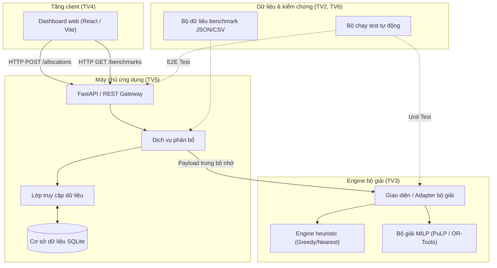
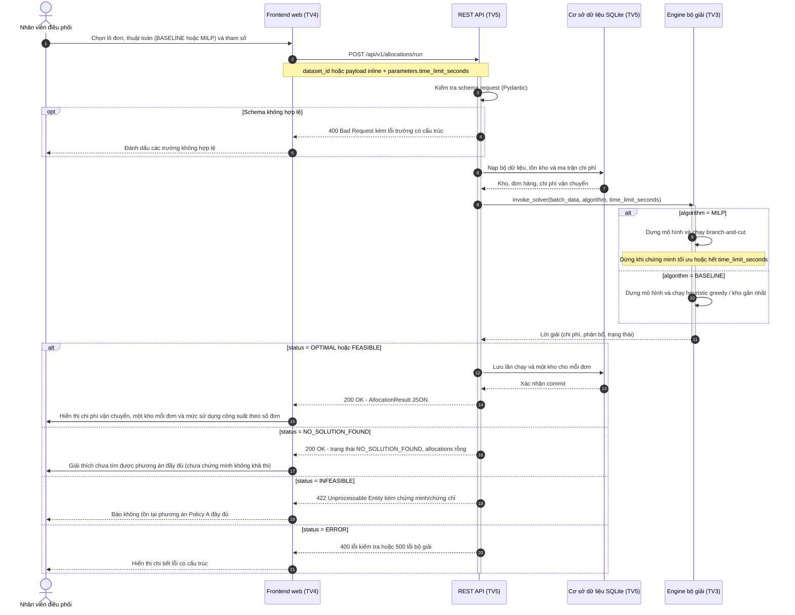

# Kiến trúc hệ thống: LogiMind

> **Trạng thái:** Kiến trúc đề xuất. Hiện đã có schema Policy A chuẩn, mười fixture, validator, generator, bộ kiểm chứng khả thi và bộ 60 test của TV2, cùng prototype cũ `scripts/validate_orders.py`. Package `src/logimind/`, backend, frontend và bộ giải **chưa** được triển khai. Các đường dẫn trong tài liệu mô tả cấu trúc dự kiến.

## 1. Triết lý kiến trúc

LogiMind theo kiến trúc 3 tầng tách biệt, mô-đun hóa:

1. **Tầng trình bày (Frontend — TV4):** trực quan hóa trạng thái kho, kích hoạt các lần chạy phân bổ và hiển thị phân tích so sánh.
2. **Tầng dịch vụ & lưu trữ (Backend & DB — TV5):** cung cấp REST API, thực thi quy tắc nghiệp vụ, lưu cấu hình và lịch sử phân bổ.
3. **Tầng tính toán (Engine tối ưu — TV3):** cài đặt heuristic baseline và mô hình MILP bằng các thư viện bộ giải chuyên dụng.
4. **Tầng dữ liệu & kiểm chứng (TV2 & TV6):** cung cấp fixture dữ liệu benchmark và bộ kiểm chứng tự động.

---

## 2. Sơ đồ thành phần

---

### 2.1. Ánh xạ repository (dự kiến)

Chưa có package hay thư mục frontend. Khi bắt đầu triển khai, code thuộc các vị trí sau:

| Thành phần | Vị trí dự kiến |
| :--- | :--- |
| Engine tối ưu (baseline + MILP) | `src/logimind/algorithms/` |
| Backend FastAPI và lớp dịch vụ | `src/logimind/backend/` |
| Truy cập dữ liệu và model lưu trữ | `src/logimind/data/` |
| Frontend React + Vite | `frontend/` |
| Bộ dữ liệu benchmark | `data/samples/` |
| Schema bộ dữ liệu dạng máy đọc | `data/schema/` |
| Tiện ích bảo trì và sinh dữ liệu | `scripts/` |
| Kiểm thử tự động | `tests/unit/`, `tests/integration/`, `tests/e2e/` |
| Tài liệu kỹ thuật | `docs/` |
| Prototype cũ (không phải Policy A) | `scripts/validate_orders.py`, `data/legacy/benchmark_data.json` |

## 3. Đánh giá công nghệ (đề xuất và ADR đang chờ)

| Thành phần | Công nghệ đề xuất | Tiêu chí đánh giá | Trạng thái |
| :--- | :--- | :--- | :--- |
| **Engine tối ưu** | Python (`PuLP` hoặc `Google OR-Tools`) | Mô hình LP/MILP dễ diễn đạt, hỗ trợ bộ giải mã nguồn mở CBC/GLPK, chuẩn cộng đồng học thuật. | Đề xuất (chờ ADR-001) |
| **Framework backend** | Python (`FastAPI`) | Hiệu năng cao, tự sinh tài liệu OpenAPI, kiểm tra Pydantic gốc, cộng hưởng trực tiếp với thư viện bộ giải Python. | Đề xuất (chờ ADR-002) |
| **Cơ sở dữ liệu** | `SQLite` | Không cấu hình, lưu dạng file, nhúng được, phù hợp dự án sinh viên và demo tất định. | Đề xuất (chờ ADR-003) |
| **Framework frontend** | `React` + `Vite` (hoặc Vue 3) | Render component nhanh, biểu đồ responsive (Recharts / Chart.js), chu kỳ build cục bộ nhanh. | Đề xuất (chưa có ADR) |
| **Bộ kiểm thử** | `pytest` + `playwright` (hoặc test request) | Kiểm thử Python chuẩn, fixture, test tham số hóa cho edge case tối ưu. | Đề xuất |

---

## 4. Luồng dữ liệu end-to-end

Ngữ nghĩa trạng thái (`OPTIMAL`, `FEASIBLE`, `INFEASIBLE`, `NO_SOLUTION_FOUND`, `ERROR`) và quy tắc timeout theo [Hợp đồng API](api-contract.md) §5. Khi bộ giải chạm `time_limit_seconds`, API trả `200` với `FEASIBLE` (nếu đã có phương án đầy đủ) hoặc `NO_SOLUTION_FOUND` (nếu chưa); không trả `504`.

---

## 5. Quy tắc bảo mật và ranh giới

1. **Ranh giới cục bộ:** trong giai đoạn học thuật, mọi thành phần chạy cục bộ hoặc trong container nhẹ.
2. **Cô lập dữ liệu:** bộ dữ liệu kiểm thử phải tách khỏi trạng thái vận hành của ứng dụng.
3. **Bảo vệ timeout bộ giải:** backend phải áp đặt giới hạn thời gian cấu hình được cho tiến trình bộ giải (ví dụ 60 giây) để tránh cạn kiệt luồng khi chạy tổ hợp phức tạp.
