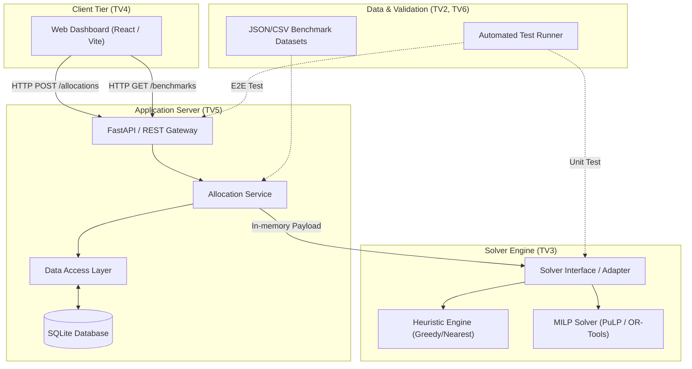

# System Architecture: LogiMind

## 1. Architectural Philosophy

LogiMind follows a decoupled, modular 3-tier architecture:
1. **Presentation Tier (Frontend - TV4):** Visualizes warehouse status, triggers allocation runs, and displays comparative analytics.
2. **Service & Persistence Tier (Backend & DB - TV5):** Exposes RESTful APIs, enforces business rules, stores configurations, and persists allocation history.
3. **Computation Tier (Optimization Engine - TV3):** Implements baseline heuristics and MILP mathematical formulations using dedicated solver libraries.
4. **Data & Verification Layer (TV2 & TV6):** Supplies benchmark data fixtures and automated verification suites.

---

## 2. Component Diagram



---

## 3. Technology Stack Evaluation (Proposed vs. Pending ADR)

| Component | Proposed Technology | Evaluation Criteria | Status |
| :--- | :--- | :--- | :--- |
| **Optimization Engine** | Python (`PuLP` or `Google OR-Tools`) | Expressive LP/MILP modeling, open-source CBC/GLPK solver support, academic community standard. | Proposed (Pending ADR-001) |
| **Backend Framework** | Python (`FastAPI`) | High performance, automatic OpenAPI documentation, native Pydantic validation, direct synergy with Python solver libraries. | Proposed (Pending ADR-002) |
| **Database** | `SQLite` | Zero-configuration, file-based, embeddable, perfect for student projects and deterministic demo evaluations. | Proposed (Pending ADR-003) |
| **Frontend Framework** | `React` + `Vite` (or Vue 3) | Fast component rendering, responsive charts (Recharts / Chart.js), rapid local build cycle. | Proposed (Pending ADR-004) |
| **Testing Harness** | `pytest` + `playwright` (or request tests) | Standard Python testing, fixtures, parameterized tests for optimization edge cases. | Proposed |

---

## 4. End-to-End Data Flow

```mermaid
sequenceDiagram
    autonumber
    actor User as Logistics Planner
    participant FE as Web Frontend (TV4)
    participant BE as REST API (TV5)
    participant DB as SQLite DB (TV5)
    participant OPT as Solver Engine (TV3)

    User->>FE: Selects order batch & parameters
    FE->>BE: POST /api/v1/allocations/run (payload)
    BE->>BE: Validate input schemas (Pydantic)
    BE->>OPT: invoke_solver(batch_data, algorithm="MILP")
    OPT->>OPT: Build model & execute branch-and-cut
    OPT-->>BE: Return Solution (cost, allocations, status)
    BE->>DB: Save allocation run record
    BE-->>FE: 200 OK (AllocationResult JSON)
    FE->>User: Display cost comparison & warehouse maps
```

---

## 5. Security & Boundary Rules

1. **Local Boundary:** In the academic phase, all components run locally or in lightweight containers.
2. **Data Isolation:** Test datasets must remain decoupled from application operational state.
3. **Solver Timeout Protection:** The backend must impose a configurable timeout on solver processes (e.g., 60 seconds) to avoid thread exhaustion during complex combinatorial runs.
