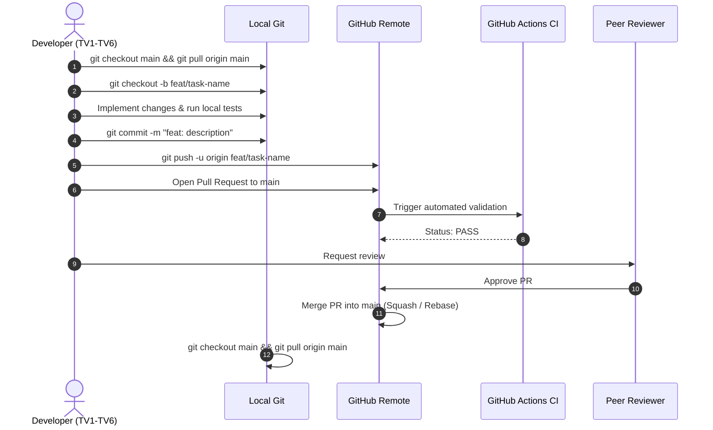

# Git Workflow & Branching Strategy: LogiMind

## 1. Principles of Collaboration

To support concurrent work across 6 team members without code collisions or lost work:
1. **Never commit directly to `main`:** The `main` branch is protected and reserved exclusively for reviewed, functional code.
2. **Branch per Task, Not per Person:** Branches are dedicated to specific deliverables (e.g. `feat/milp-solver`, `docs/math-model`), never personal branches (e.g. `tv1-work`). This ensures clarity when multiple members review or collaborate on a feature.
3. **Short-Lived Branches:** Keep task branches scoped to 1–3 days of work. Small, frequent PRs are easier to review than massive end-of-semester branches.

---

## 2. Branch Naming Conventions

All branch names must use lower-case kebab-case prefixed by the category:

| Branch Name Pattern | Category | Use When |
| :--- | :--- | :--- |
| `docs/<topic>` | Documentation | Writing or updating specifications, mathematical models, or guides. |
| `feat/<topic>` | Feature | Implementing an algorithm, API endpoint, or UI component. |
| `fix/<topic>` | Bug Fix | Correcting mathematical violations, broken tests, or API bugs. |
| `test/<topic>` | Testing | Adding automated test suites or edge-case benchmark datasets. |
| `chore/<topic>` | Housekeeping | Updating dependencies, linters, or CI workflow configuration. |

*Examples:*
- `docs/add-infeasible-policy`
- `feat/baseline-greedy-heuristic`
- `feat/backend-run-endpoint`
- `test/infeasible-capacity-fixtures`
- `fix/split-penalty-multiplier`

---

## 3. Step-by-Step Task Lifecycle (10 Steps)



### Detailed Command Walkthrough

#### Step 1: Sync with Latest Main
```bash
git checkout main
git pull origin main
```

#### Step 2: Create a Fresh Task Branch
```bash
git checkout -b feat/implement-greedy-baseline
```

#### Step 3: Implement & Self-Review
Edit the necessary files. Check status frequently:
```bash
git status --short
git diff
```

#### Step 4: Run Tests Locally
Verify that no constraints are broken:
```bash
# Example test run (once environment is configured)
pytest tests/
```

#### Step 5: Commit using Conventional Commits
```bash
git add src/algorithms/baseline.py tests/test_algorithms/test_baseline.py
git commit -m "feat: implement greedy nearest-warehouse allocation heuristic"
```

#### Step 6: Push Branch to Remote
```bash
git push -u origin feat/implement-greedy-baseline
```

#### Step 7: Open Pull Request (PR)
- Go to the GitHub repository page.
- Click **Compare & pull request**.
- Fill out the PR template completely.

#### Step 8: Peer Review & CI Verification
- Request review from at least one peer member (e.g. TV3 reviews TV1's model, TV5 reviews TV4's API requests).
- Verify GitHub Actions CI status is green.

#### Step 9: Merge
- Merge into `main` using "Squash and merge" or "Rebase and merge".

#### Step 10: Clean Up
```bash
git checkout main
git pull origin main
git branch -d feat/implement-greedy-baseline
```

---

## 4. Keeping Your Branch Updated & Handling Merge Conflicts

If `main` has advanced while your task branch was active, sync your branch safely:

```bash
# 1. Update your local main
git checkout main
git pull origin main

# 2. Merge main into your task branch
git checkout feat/your-branch-name
git merge main
```

If Git detects conflicting edits:
1. Open the conflicted files. Search for conflict markers:
   ```text
   <<<<<<< HEAD (Current change on your branch)
   your changes
   =======
   incoming changes from main
   >>>>>>> main
   ```
2. Manually adjust the code to integrate both changes correctly.
3. Remove the marker lines (`<<<<<<<`, `=======`, `>>>>>>>`).
4. Run tests to confirm the resolution works.
5. Stage and commit:
   ```bash
   git add <resolved-files>
   git commit -m "chore: resolve merge conflicts with main"
   git push origin feat/your-branch-name
   ```

---

## 5. Prohibited Git Actions

The following commands are strictly prohibited on shared branches:
- `git push --force` (Use `--force-with-lease` only on private task branches if rebasing, never on `main`).
- `git reset --hard` (Risk of permanent work loss).
- Direct commits to `main`.
- Storing unencrypted credentials, passwords, or API tokens.
