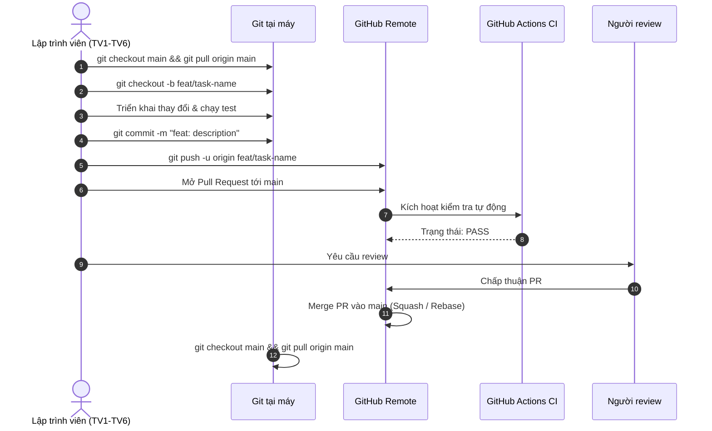

# Quy trình Git & chiến lược nhánh: LogiMind

> **Lưu ý:** Đây là bản tóm tắt kèm ví dụ minh họa. Quy trình chính thức và đầy đủ nằm tại [`CONTRIBUTING.md`](../CONTRIBUTING.md); nếu hai tài liệu khác nhau, `CONTRIBUTING.md` là nguồn có hiệu lực.

## 1. Nguyên tắc cộng tác

Để 6 thành viên làm việc song song mà không xung đột code hoặc mất việc:

1. **Không commit trực tiếp vào `main`:** `main` được bảo vệ và chỉ dành cho code đã review, chạy được.
2. **Mỗi nhiệm vụ một nhánh, không phải mỗi người một nhánh:** nhánh gắn với hạng mục bàn giao cụ thể (ví dụ `feat/milp-solver`, `docs/math-model`), không dùng nhánh cá nhân (ví dụ `tv1-work`). Điều này giúp nhiều người review hoặc cộng tác trên cùng tính năng.
3. **Nhánh ngắn hạn:** giữ nhánh nhiệm vụ trong khoảng 1–3 ngày làm việc. PR nhỏ, thường xuyên dễ review hơn nhánh lớn cuối kỳ.

---

## 2. Quy ước đặt tên nhánh

Mọi tên nhánh dùng chữ thường kebab-case, có tiền tố theo loại:

| Mẫu tên nhánh | Loại | Dùng khi |
| :--- | :--- | :--- |
| `docs/<topic>` | Tài liệu | Viết hoặc cập nhật đặc tả, mô hình toán học, hướng dẫn. |
| `feat/<topic>` | Tính năng | Cài đặt thuật toán, endpoint API hoặc thành phần UI. |
| `fix/<topic>` | Sửa lỗi | Sửa vi phạm toán học, test hỏng hoặc lỗi API. |
| `test/<topic>` | Kiểm thử | Thêm bộ test tự động hoặc bộ dữ liệu benchmark edge case. |
| `chore/<topic>` | Việc vặt | Cập nhật dependency, linter hoặc cấu hình CI. |

*Ví dụ:*

- `docs/add-infeasible-policy`
- `feat/baseline-greedy-heuristic`
- `feat/backend-run-endpoint`
- `test/infeasible-capacity-fixtures`
- `fix/capacity-overflow-check`

---

## 3. Vòng đời nhiệm vụ (10 bước)



### Hướng dẫn lệnh chi tiết

#### Bước 1: Đồng bộ với `main` mới nhất

```bash
git checkout main
git pull origin main
```

#### Bước 2: Tạo nhánh nhiệm vụ mới

```bash
git checkout -b feat/implement-greedy-baseline
```

#### Bước 3: Triển khai & tự review

Sửa các file cần thiết. Kiểm tra trạng thái thường xuyên:

```bash
git status --short
git diff
```

#### Bước 4: Chạy test tại máy

Xác nhận không có ràng buộc nào bị vi phạm:

```bash
# Ví dụ chạy test (sau khi môi trường đã được cấu hình)
pytest tests/
```

#### Bước 5: Commit theo Conventional Commits

```bash
git add src/logimind/algorithms/baseline.py tests/unit/test_baseline.py
git commit -m "feat: implement greedy nearest-warehouse allocation heuristic"
```

#### Bước 6: Push nhánh lên remote

```bash
git push -u origin feat/implement-greedy-baseline
```

#### Bước 7: Mở Pull Request (PR)

- Truy cập trang repository trên GitHub.
- Nhấn **Compare & pull request**.
- Điền đầy đủ mẫu PR.

#### Bước 8: Review và kiểm tra CI

- Yêu cầu ít nhất một thành viên khác review (ví dụ TV3 review mô hình của TV1, TV5 review yêu cầu API của TV4).
- Xác nhận trạng thái GitHub Actions CI xanh.

#### Bước 9: Merge

- Merge vào `main` bằng **Squash and merge** hoặc **Rebase and merge**.

#### Bước 10: Dọn dẹp

```bash
git checkout main
git pull origin main
git branch -d feat/implement-greedy-baseline
```

---

## 4. Cập nhật nhánh và xử lý xung đột merge

Nếu `main` tiến lên trong lúc nhánh nhiệm vụ đang mở, đồng bộ nhánh an toàn:

```bash
# 1. Cập nhật main tại máy
git checkout main
git pull origin main

# 2. Merge main vào nhánh nhiệm vụ
git checkout feat/your-branch-name
git merge main
```

Nếu Git phát hiện xung đột:

1. Mở các file xung đột và tìm dấu đánh dấu:

   ```text
   <<<<<<< HEAD (Thay đổi hiện tại trên nhánh của bạn)
   your changes
   =======
   incoming changes from main
   >>>>>>> main
   ```

2. Chỉnh code thủ công để tích hợp đúng cả hai bên.
3. Xóa các dòng đánh dấu (`<<<<<<<`, `=======`, `>>>>>>>`).
4. Chạy test để xác nhận bản giải quyết hoạt động.
5. Stage và commit:

   ```bash
   git add <resolved-files>
   git commit -m "chore: resolve merge conflicts with main"
   git push origin feat/your-branch-name
   ```

---

## 5. Hành vi Git bị cấm

Các lệnh sau bị cấm tuyệt đối trên nhánh dùng chung:

- `git push --force` (chỉ dùng `--force-with-lease` trên nhánh nhiệm vụ riêng khi rebase, không bao giờ trên `main`).
- `git reset --hard` (nguy cơ mất việc vĩnh viễn).
- Commit trực tiếp vào `main`.
- Lưu thông tin đăng nhập, mật khẩu hoặc API token không mã hóa.

> Quy trình đầy đủ, quy tắc bảo vệ nhánh và checklist review: [`CONTRIBUTING.md`](../CONTRIBUTING.md).
