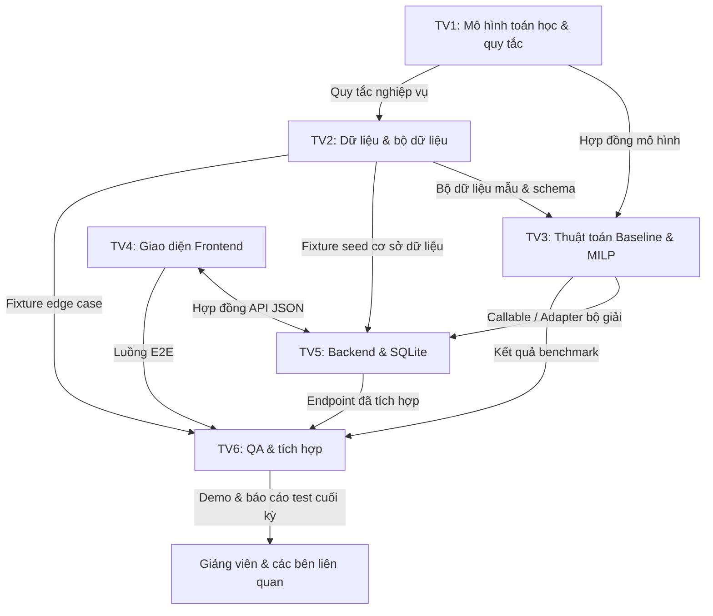

# Hướng dẫn tích hợp & bàn giao module: LogiMind

## 1. Tổng quan & nguyên tắc bàn giao

Để 6 thành viên (TV1 đến TV6) làm việc song song mà không chặn nhau hoặc tạo nghẽn tích hợp, quá trình phát triển được điều hành bằng **hợp đồng bàn giao tường minh**.

Mỗi ranh giới module có:

- một bên cung cấp và một bên tiêu thụ được chỉ định;
- định dạng đầu vào và đầu ra được quy định rõ;
- một **Checklist bàn giao** chuẩn phải hoàn thành trước khi merge nhánh tính năng vào `main`.

**Chính sách hiện hành:** Policy A (phân bổ nghiêm ngặt không tách đơn), ghi tại [ADR-004](decisions/0004-allocation-policy-a.md). Hợp đồng bộ dữ liệu chuẩn là [`data/schema/dataset.schema.json`](../data/schema/dataset.schema.json) cùng [`docs/data-dictionary.md`](data-dictionary.md); hợp đồng API là [api-contract.md](api-contract.md). Ánh xạ trường/quy tắc TV1–TV6 nằm tại [Hợp đồng API §6](api-contract.md#6-tv1tv6-integration-mapping).

---

## 2. Sơ đồ phụ thuộc & bàn giao giữa các vai trò

---

## 3. Checklist bàn giao chuẩn theo module

Khi một vai trò hoàn thành mốc, họ phải kiểm tra và công bố checklist trong Pull Request tương ứng.

### 3.1. TV1 (Mô hình toán học) $\to$ TV3 & TV2

- [ ] **Hạng mục:** `docs/mathematical-model.md` được hình thức hóa đầy đủ.
- [ ] **Đầu vào & tham số:** ký hiệu chỉ số rõ ràng, đơn vị và biên của tham số.
- [ ] **Ràng buộc:** phương trình toán học không mơ hồ cho công suất, tồn kho theo SKU và gán một kho cho mỗi đơn.
- [ ] **Chính sách không khả thi:** quy tắc cụ thể khi cầu vượt cung dưới Policy A (kết quả không khả thi; không có penalty cho đơn chưa gán).
- [ ] **Kiểm chứng:** có kiểm chứng thủ công trên ví dụ nhỏ 2 kho.
- [ ] **Phối hợp hạ nguồn:** đã hoàn tất buổi walkthrough với TV3 và TV2.

---

### 3.2. TV2 (Dữ liệu & bộ dữ liệu benchmark) $\to$ TV3, TV5, TV6

- [x] **Hạng mục:** `data/samples/` có mười fixture Policy A chuẩn (nhỏ, vừa, lớn, không khả thi và sáu edge case).
- [x] **Tuân thủ schema:** dữ liệu hợp lệ theo `data/schema/dataset.schema.json` và `docs/data-dictionary.md`.
- [x] **Script kiểm tra:** `scripts/validate_dataset.py` kiểm tra một file hoặc một thư mục.
- [x] **Bộ kiểm chứng khả thi:** `scripts/check_feasibility.py` trả `FEASIBLE`/`INFEASIBLE`/`UNKNOWN`/`INVALID` cho bài toán nhỏ.
- [x] **Generator:** `scripts/generate_dataset.py` sinh bộ dữ liệu tất định, khả thi theo cách dựng.
- [x] **Hạn chế đã biết:** các fixture cố ý không khả thi được ghi tại `data/README.md`.
- [x] **Test tự động:** `tests/test_datasets.py` (60 test).
- [ ] **Phối hợp hạ nguồn:** TV3 và TV5 đã xác nhận bộ dữ liệu nạp sạch trong môi trường của họ.

---

### 3.3. TV3 (Thuật toán) $\to$ TV5 & TV6

- [ ] **Hạng mục:** module thuật toán trong `src/logimind/algorithms/`, cung cấp callable chuẩn:
  `solve_allocation(problem_data: ProblemInput, algorithm: str) -> SolutionOutput`.
- [ ] **Tuân thủ Policy A:** mỗi đơn được gán cho đúng một kho và giao đầy đủ; không có phương án dự phòng tách đơn hoặc bỏ đơn.
- [ ] **Cài đặt Baseline:** heuristic greedy hoặc kho gần nhất hoạt động đầy đủ.
- [ ] **Cài đặt MILP:** mô hình bộ giải được dựng, đặt biên và kiểm thử.
- [ ] **Ngữ nghĩa trạng thái:** trả `OPTIMAL`, `FEASIBLE`, `INFEASIBLE`, `NO_SOLUTION_FOUND` hoặc `ERROR` theo [Hợp đồng API §5](api-contract.md#5-solver-status-semantics-and-timeout-handling).
- [ ] **Tái lập:** bộ giải cho kết quả tất định trên cùng seed/đầu vào.
- [ ] **Minh chứng benchmark:** log thực thi cho thấy chi phí MILP $\le$ chi phí Baseline trên bộ dữ liệu mẫu.
- [ ] **Unit test:** test có độ bao phủ cao trong `tests/unit/`, chạy pass.

---

### 3.4. TV4 (Frontend) $\to$ TV5 & TV6

- [ ] **Hạng mục:** dashboard UI trong `frontend/` (hoặc thư mục web client).
- [ ] **Mock API:** frontend chạy được với JSON server mock tuân theo `docs/api-contract.md`.
- [ ] **Thành phần trực quan:**
  - Chọn/tải lên lô đơn hàng.
  - Biểu đồ so sánh chi phí (Baseline và MILP).
  - Đồng hồ mức sử dụng công suất kho.
  - Chi tiết gán đơn cho kho.
- [ ] **Thiết kế responsive:** hoạt động trên độ phân giải laptop tiêu chuẩn.
- [ ] **Phối hợp hạ nguồn:** endpoint đã được kiểm chứng với backend thật của TV5.

---

### 3.5. TV5 (Backend & cơ sở dữ liệu) $\to$ TV4 & TV6

- [ ] **Hạng mục:** ứng dụng REST API trong `src/logimind/backend/` và model cơ sở dữ liệu SQLite.
- [ ] **Tuân thủ hợp đồng:** endpoint bám sát `docs/api-contract.md`; bộ dữ liệu inline hợp lệ theo JSON Schema chuẩn.
- [ ] **Tích hợp bộ giải:** backend gọi được engine của TV3 với giới hạn timeout phù hợp.
- [ ] **Lưu trữ:** lịch sử chạy và phương án phân bổ được lưu và đọc lại từ SQLite.
- [ ] **Xử lý lỗi/trạng thái:** trả HTTP `400` cho lỗi kiểm tra, `422` cho `INFEASIBLE` đã chứng minh, và `200` với `OPTIMAL`/`FEASIBLE`/`NO_SOLUTION_FOUND` cho các lần tính hoàn tất. Hết thời gian bộ giải **không** trả `504`.
- [ ] **Cấu trúc phản hồi:** một `warehouse_id` cho mỗi đơn; mức sử dụng tính theo số đơn qua `capacity_orders`; không có trường split/penalty/handling.
- [ ] **Script chạy cục bộ:** lệnh khởi động server được ghi tài liệu (ví dụ `uvicorn logimind.backend.main:app`).

---

### 3.6. TV6 (Tích hợp, kiểm thử & báo cáo) $\to$ Nhóm & giảng viên

- [ ] **Hạng mục:** bộ kiểm thử tự động (`tests/`), workflow kiểm chứng, báo cáo thuyết trình cuối kỳ.
- [ ] **Bộ E2E:** script tự động chạy: Seed Data $\to$ Backend API $\to$ Solver $\to$ kiểm chứng Database.
- [ ] **Test lỗi & không khả thi:** bao phủ toàn bộ edge case trong `docs/testing-strategy.md`.
- [ ] **CI pass:** GitHub Actions CI xanh trên `main`.
- [ ] **Hướng dẫn demo:** kịch bản walkthrough từng bước cho buổi bảo vệ trước giảng viên.
