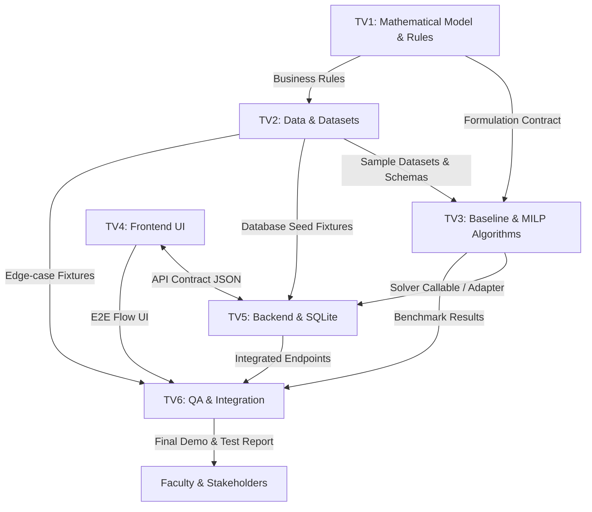

# Integration & Module Handoff Guide: LogiMind

## 1. Overview & Handoff Principles

To enable 6 members (TV1 through TV6) to work concurrently without blocking each other or causing integration bottlenecks, development is governed by **explicit handoff contracts**.

Every module boundary has:
- A designated provider and consumer.
- Clearly specified input and output formats.
- A standardized **Handoff Checklist** that must be fulfilled before a feature branch is merged into `main`.

**Current policy:** Policy A (strict non-split allocation), recorded in
[ADR-004](decisions/0004-allocation-policy-a.md). The canonical dataset contract
is [`data/schema/dataset.schema.json`](../data/schema/dataset.schema.json) with
[`docs/data-dictionary.md`](data-dictionary.md); the API contract is
[api-contract.md](api-contract.md). The TV1–TV6 field/rule mapping is in
[API Contract §6](api-contract.md#6-tv1tv6-integration-mapping).

---

## 2. Cross-Role Dependency & Handoff Map

---

## 3. Standard Module Handoff Checklists

Whenever a role completes a milestone, they must verify and publish their checklist in the corresponding Pull Request.

### 3.1 TV1 (Mathematical Model) $\to$ TV3 & TV2
- [ ] **Artifact:** `docs/mathematical-model.md` fully formalized.
- [ ] **Inputs & Parameters:** Clear index notation, unit specifications, and parameter boundaries.
- [ ] **Constraints:** Unambiguous mathematical equations for capacity, per-SKU inventory, and single-warehouse assignment.
- [ ] **Infeasibility Policy:** Concrete rule for handling over-demand under Policy A (infeasible result; no unassigned penalty).
- [ ] **Verification:** Manual verification on a 2-warehouse toy example documented.
- [ ] **Downstream Coordination:** Walkthrough meeting completed with TV3 and TV2.

---

### 3.2 TV2 (Data & Benchmark Datasets) $\to$ TV3, TV5, TV6
- [x] **Artifacts:** `data/samples/` contains ten canonical Policy A fixtures (small, medium, large, infeasible, and six edge cases).
- [x] **Schema Conformance:** Data validates against `data/schema/dataset.schema.json` and `docs/data-dictionary.md`.
- [x] **Validation Script:** `scripts/validate_dataset.py` validates a file or directory.
- [x] **Feasibility Oracle:** `scripts/check_feasibility.py` reports `FEASIBLE`/`INFEASIBLE`/`UNKNOWN`/`INVALID` for small instances.
- [x] **Generator:** `scripts/generate_dataset.py` produces deterministic, feasible-by-construction datasets.
- [x] **Known Limitations:** Intentionally infeasible fixtures are documented in `data/README.md`.
- [x] **Automated Tests:** `tests/test_datasets.py` (60 tests).
- [ ] **Downstream Coordination:** TV3 and TV5 verified datasets load cleanly in their environments.

---

### 3.3 TV3 (Algorithms) $\to$ TV5 & TV6
- [ ] **Artifacts:** Algorithm modules under `src/logimind/algorithms/` exposing a standard callable:
  `solve_allocation(problem_data: ProblemInput, algorithm: str) -> SolutionOutput`.
- [ ] **Policy A Compliance:** Each order is assigned to exactly one warehouse and fulfilled completely; no split or unassigned fallback.
- [ ] **Baseline Implementation:** Greedy or nearest-warehouse heuristic fully operational.
- [ ] **MILP Implementation:** Solver model formulated, bounded, and tested.
- [ ] **Status Semantics:** Returns `OPTIMAL`, `FEASIBLE`, `INFEASIBLE`, `NO_SOLUTION_FOUND`, or `ERROR` per [API Contract §5](api-contract.md#5-solver-status-semantics-and-timeout-handling).
- [ ] **Reproducibility:** Solvers yield deterministic outputs on identical seeds/inputs.
- [ ] **Benchmark Proof:** Execution log showing MILP cost $\le$ Baseline cost on sample datasets.
- [ ] **Unit Tests:** High-coverage tests under `tests/unit/` passing cleanly.

---

### 3.4 TV4 (Frontend) $\to$ TV5 & TV6
- [ ] **Artifacts:** UI dashboard under `frontend/` (or web client folder).
- [ ] **API Mocking:** Frontend can run against mock JSON server adhering to `docs/api-contract.md`.
- [ ] **Visual Elements:**
  - Order batch selection / upload.
  - Cost comparison chart (Baseline vs. MILP).
  - Warehouse capacity utilization gauges.
  - Order-to-warehouse assignment details.
- [ ] **Responsive Design:** Functional on standard laptop screen resolutions.
- [ ] **Downstream Coordination:** Endpoints verified against TV5 live backend.

---

### 3.5 TV5 (Backend & Database) $\to$ TV4 & TV6
- [ ] **Artifacts:** REST API application under `src/logimind/backend/` and SQLite database models.
- [ ] **Contract Compliance:** Endpoints strictly adhere to `docs/api-contract.md`; inline datasets validate against the canonical JSON Schema.
- [ ] **Solver Integration:** Backend successfully calls TV3 solver engine with proper timeout guards.
- [ ] **Persistence:** Run history and allocation plans successfully stored and retrieved from SQLite.
- [ ] **Error/Status Handling:** Returns HTTP `400` for validation errors, `422` for proven `INFEASIBLE`, and `200` with `OPTIMAL`/`FEASIBLE`/`NO_SOLUTION_FOUND` for completed computations. Solver time-limit is not `504`.
- [ ] **Response Shape:** One `warehouse_id` per order; usage counted in orders via `capacity_orders`; no split/penalty/handling fields.
- [ ] **Local Run Script:** Documented command to boot server locally (e.g., `uvicorn logimind.backend.main:app`).

---

### 3.6 TV6 (Integration, Testing & Reporting) $\to$ Team & Faculty
- [ ] **Artifacts:** Automated test suites (`tests/`), validation workflows, final presentation report.
- [ ] **End-to-End Suite:** Automated script executing: Seed Data $\to$ Backend API $\to$ Solver $\to$ Database verification.
- [ ] **Negative & Infeasibility Tests:** All edge cases in `docs/testing-strategy.md` covered.
- [ ] **CI Pass:** GitHub Actions CI green on `main`.
- [ ] **Demo Guide:** Step-by-step walkthrough script prepared for final demonstration before the faculty.
