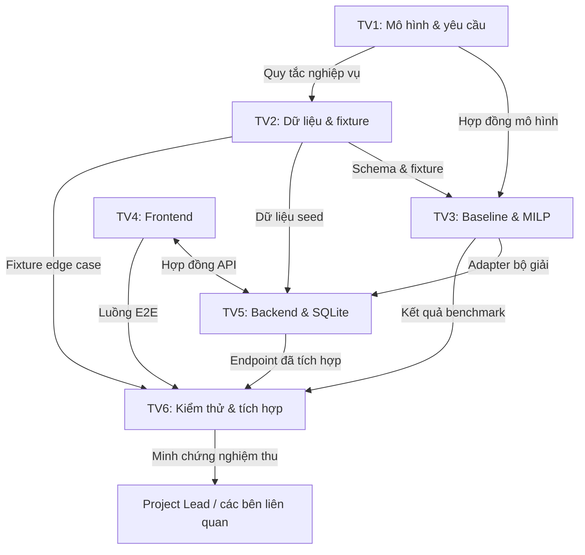

# Kế hoạch tích hợp LogiMind

> **Chủ sở hữu:** TV6 (Tích hợp, Kiểm thử & Báo cáo), phối hợp với Project Lead
> **Kiểm chứng lần cuối:** 2026-11-11
> **Baseline:** `main` tại `f7f5862`
> **Nguyên tắc:** Kế hoạch chỉ dùng giao diện và schema đã được ghi trong repository. Tài liệu không định nghĩa hoặc tự tạo quy tắc toán học, trường API hay hành vi module mới.

---

## 1. Nguồn chân lý

| Chủ đề | Tài liệu hiện có |
| :--- | :--- |
| Quy tắc nghiệp vụ, tập hợp, tham số, ràng buộc | [mathematical-model.md](../mathematical-model.md), [requirements.md](../requirements.md) |
| Ranh giới module và checklist bàn giao | [integration-guide.md](../integration-guide.md) |
| Thành phần dự kiến và luồng dữ liệu | [architecture.md](../architecture.md) |
| Endpoint và payload API | [api-contract.md](../api-contract.md) *(đã căn chỉnh Policy A)* |
| Thực thể dữ liệu | [data-dictionary.md](../data-dictionary.md) *(chuẩn cho Policy A; Phụ lục A mô tả prototype cũ)* |
| Bậc test và edge case | [testing-strategy.md](../testing-strategy.md) |
| Quyết định kỹ thuật | [Chỉ mục ADR](../decisions/README.md) — ADR-001..003 vẫn `PROPOSED` |

Nếu các tài liệu này xung đột, xung đột là blocker phải giải quyết **trước** khi tích hợp cài đặt. Xung đột đã biết được ghi tại [project-status §4](project-status.md#4-blocker-và-phụ-thuộc).

---

## 2. Sơ đồ phụ thuộc module hiện có

Lấy từ [integration-guide §2](../integration-guide.md):

**Trạng thái triển khai thực tế:** TV1 đã có tài liệu; TV2 đã triển khai lớp dữ liệu và bộ test (PR #11, #13 đã merge). TV3, TV4 và TV5 chưa có cài đặt trong thư mục được giao. `scripts/validate_orders.py` là prototype độc lập, không phải module tích hợp.

---

## 3. Trình tự tích hợp và cổng sẵn sàng

Các cổng tuần tự. Một cổng chỉ mở khi minh chứng thoát của nó có trong repository.

| Cổng | Điều kiện vào | Artifact bắt buộc | Kiểm chứng | Điều kiện ra | Trạng thái hiện tại |
| :--- | :--- | :--- | :--- | :--- | :--- |
| **G0 — Quy tắc và schema** | Mô hình Policy A của TV1 và hợp đồng dữ liệu chuẩn của TV2 tồn tại | Quyết định Policy A ([ADR-004](../decisions/0004-allocation-policy-a.md)); schema và từ điển chuẩn; quy tắc công suất/SKU/chi phí được ghi | Project Lead quyết định; TV1/TV2 công bố | Quy tắc không mơ hồ và một schema là chính thức | **In Progress** — đã công bố; TV3/TV5/TV6 chưa áp dụng |
| **G1 — Hợp đồng được chốt** | G0 hoàn tất | Hợp đồng API Policy A với `OPTIMAL`/`FEASIBLE`/`INFEASIBLE`/`NO_SOLUTION_FOUND`/`ERROR`; payload bộ dữ liệu chuẩn | TV1/TV3/TV5/TV4 review; payload mẫu được kiểm tra | Hợp đồng được đánh phiên bản và không còn lệch đã biết | **In Progress** — đã căn chỉnh; chờ sign-off cài đặt |
| **G2 — Fixture sẵn sàng** | G0, G1 hoàn tất | Mười fixture chuẩn; validator schema; bộ kiểm chứng khả thi | TV2 chạy validator; TV6 kiểm tra độc lập schema và edge case | Mọi fixture pass kiểm tra; kết quả mong đợi được ghi | **Completed (TV2)** — TV6 kiểm chứng độc lập còn chờ |
| **G3 — Bộ giải sẵn sàng** | G1, G2 hoàn tất | Baseline, MILP, adapter bộ giải, unit test, báo cáo benchmark | TV3 chạy test; TV6 kiểm tra bất biến độc lập | Bộ giải dùng đầu vào chuẩn và trả output theo hợp đồng | **Not Started** |
| **G4 — Backend sẵn sàng** | G3 hoàn tất | Endpoint FastAPI, schema/migration SQLite, lưu trữ, xử lý timeout, contract test | Test TV5; contract test của TV6 trên fixture | API khớp hợp đồng đã chốt, lưu và đọc lại kết quả | **Not Started** |
| **G5 — Frontend sẵn sàng** | G1, G4 hoàn tất | UI chạy với mock API rồi API thật; lệnh khởi động được ghi; luồng E2E | Demo TV4; walkthrough E2E của TV6 | Người dùng chọn dữ liệu, chạy phân bổ và xem kết quả | **Not Started** |
| **G6 — Nghiệm thu hệ thống** | G2–G5 hoàn tất | Báo cáo test đã chạy; so sánh benchmark; minh chứng E2E; hạn chế đã biết | TV6 chạy toàn bộ test trong CI; Project Lead review | Tiêu chí nghiệm thu đạt; gói minh chứng được lưu | **Not Started** |

### Chính sách cổng

- Không mở cổng hạ nguồn dựa trên giả định. Nếu một trường, trạng thái hoặc đơn vị chưa xác định, cổng giữ blocked.
- Cổng có thể mở lại nếu hợp đồng thượng nguồn thay đổi.
- Ghi rõ mọi mock hoặc stub tạm thời; mock không được tính là minh chứng tích hợp.

---

## 4. Artifact bàn giao bắt buộc

Lấy từ [integration-guide §3](../integration-guide.md). Bên cung cấp sở hữu artifact; bên tiêu thụ kiểm chứng; TV6 ghi minh chứng.

| Từ | Đến | Artifact bắt buộc | Minh chứng nghiệm thu |
| :--- | :--- | :--- | :--- |
| **TV1** | TV2, TV3 | Mô hình đã duyệt, định nghĩa tham số, quyết định chính sách, ví dụ tính tay, ngữ nghĩa trạng thái | Quyết định/ADR đã duyệt; ví dụ tái lập; checklist bàn giao hoàn tất |
| **TV2** | TV3, TV5, TV6 | Schema chuẩn, fixture đã kiểm tra, generator/validator, kết quả mong đợi | Output validator; danh mục fixture; phiên bản schema |
| **TV3** | TV5, TV6 | Adapter bộ giải, hợp đồng vào/ra, unit test, kết quả benchmark, hành vi timeout/lỗi | Output test; chữ ký adapter; bảng benchmark |
| **TV5** | TV4, TV6 | Cài đặt API, ví dụ request/response, schema lưu trữ, contract test | Output contract test; bản ghi endpoint; minh chứng đọc lại DB |
| **TV4** | TV6 | UI chạy được, hướng dẫn khởi động, cấu hình API, walkthrough E2E | Bản ghi walkthrough/ảnh chụp; E2E test |
| **TV6** | Project Lead | Báo cáo cổng, ma trận truy vết, minh chứng test, rủi ro, khuyến nghị nghiệm thu | Quyết định cổng đã ký; minh chứng liên kết |

### Quy tắc chất lượng bàn giao

- Mọi artifact phải được đánh phiên bản hoặc liên kết tới commit/PR.
- Bàn giao chưa hoàn tất nếu bên tiêu thụ không thể chạy hoặc kiểm chứng chỉ từ repository.
- Không dùng ảnh chụp hoặc văn xuôi thay cho minh chứng thực thi khi cần thực thi.
- Các mục trong [integration-guide](../integration-guide.md) vẫn là mức tối thiểu; kế hoạch này không thay thế.

---

## 5. Checklist kiểm chứng giao diện

Dùng checklist này tại G1–G5. "Hiện tại" phản ánh repository trong ngày kiểm chứng.

### 5.1. Hợp đồng dữ liệu

- [ ] Tên trường, kiểu, khả năng null và đơn vị khớp một schema đã duyệt
- [ ] Đơn vị công suất được định nghĩa nhất quán (số đơn và số đơn vị sản phẩm)
- [ ] Tồn kho theo SKU có mặt cho mọi cặp kho–SKU
- [ ] Chi phí vận chuyển `c_ij` có mặt/được suy ra theo một quy tắc đã ghi
- [x] Không có penalty cho đơn chưa gán (Policy A)
- [x] Gán một kho được thực thi; giao tách đơn bị loại trừ
- [ ] Mã fixture, phiên bản và kết quả mong đợi được ghi

**Hiện tại:** TV2 đã công bố schema Policy A chuẩn, từ điển và fixture chuẩn (PR #11 đã merge). Fixture prototype cũ được tách trong `data/legacy/` và không thuộc hợp đồng. Việc TV3/TV5/TV6 áp dụng vẫn mở. Xem [project-status §4](project-status.md#4-blocker-và-phụ-thuộc).

### 5.2. Hợp đồng adapter bộ giải

- [ ] Tên/chữ ký callable khớp giao diện đã thống nhất để tích hợp
- [ ] Kiểm tra đầu vào từ chối dữ liệu sai hoặc thiếu trường bắt buộc
- [ ] Output gồm phân bổ/đơn chưa gán, thành phần chi phí, trạng thái và tài nguyên còn lại
- [ ] Từ vựng trạng thái lời giải được thống nhất và ánh xạ nhất quán
- [ ] Phá hòa tất định hoặc được ghi rõ
- [ ] Hành vi timeout và lỗi bộ giải được định nghĩa
- [ ] Bộ giải không thay đổi dữ liệu đầu vào dùng chung
- [ ] Phạm vi đo thời gian chạy được ghi

**Hiện tại:** chưa triển khai. Adapter dự kiến được mô tả tại [integration-guide §3.3](../integration-guide.md); chưa có code.

### 5.3. Hợp đồng API

- [ ] Endpoint và method khớp hợp đồng đã duyệt
- [ ] Envelope thành công/lỗi khớp hợp đồng đã duyệt
- [ ] Lỗi kiểm tra, không khả thi và timeout ánh xạ tới HTTP status đã ghi
- [ ] Trạng thái bộ giải ánh xạ tới giá trị trạng thái API không mơ hồ
- [ ] Phản hồi chứa chỉ số mà mô hình/yêu cầu đã duyệt cần
- [ ] Ví dụ request/response chạy được với cài đặt thực tế

**Hiện tại:** [api-contract.md](../api-contract.md) đã căn chỉnh Policy A với năm trạng thái bắt buộc và không có trường split/penalty/handling. Chưa có backend; cài đặt TV5 và sign-off TV1/TV3/TV4/TV5 vẫn mở.

### 5.4. Lưu trữ

- [ ] Schema và migration khớp thực thể chuẩn
- [ ] Toàn vẹn tham chiếu được thực thi cho đơn, dòng đơn, kho, tồn kho và lần chạy
- [ ] Lần chạy đã lưu đọc lại với cấu hình, phân bổ và chỉ số giống hệt
- [ ] File cơ sở dữ liệu được Git bỏ qua
- [ ] Quy trình migration/seed được ghi và tái lập được

**Hiện tại:** chưa có schema hoặc migration; ADR-003 vẫn `PROPOSED`. `.gitignore` hiện đã bỏ qua `*.db`, `*.sqlite`, `*.sqlite3`.

### 5.5. Frontend

- [ ] UI chạy ở chế độ mock mà không cần backend
- [ ] UI chuyển sang API thật mà không cần sửa code ngoài cấu hình
- [ ] Trạng thái kiểm tra lỗi, không khả thi, timeout và lỗi server hiển thị được
- [ ] Phân bổ, phân rã chi phí, mức sử dụng và trạng thái chỉ dùng trường Policy A đã ghi (một kho mỗi đơn)
- [ ] Luồng E2E được ghi cho TV6

**Hiện tại:** chưa có file frontend hoặc package manifest.

### 5.6. Xuyên suốt

- [ ] Cùng đầu vào và cấu hình cho cùng kết quả (seed/phiên bản được ghi)
- [ ] Không commit secret, `.env`, file cơ sở dữ liệu hoặc dữ liệu thô
- [ ] Minh chứng test gồm lệnh, môi trường và output quan sát
- [ ] Trạng thái tài liệu khớp trạng thái triển khai
- [ ] CI chạy test và được yêu cầu trước khi merge

**Hiện tại:** CI chạy kiểm tra vệ sinh và job test TV2; required-status-check chưa được bật.

---

## 6. Blocker tích hợp

| Blocker | Ảnh hưởng tới tích hợp | Chủ sở hữu giải quyết | Minh chứng |
| :--- | :--- | :--- | :--- |
| Quy tắc nghiệp vụ chưa được nhóm xác nhận | G0 chưa mở hoàn toàn; hợp đồng hạ nguồn chưa ổn định | TV1 / Project Lead | [project-status B-01](project-status.md#4-blocker-và-phụ-thuộc) |
| ~~Không có schema chuẩn~~ | ~~Dữ liệu không qua được ranh giới module~~ | TV2 | **Đã giải quyết cho TV2**; project-status B-02 |
| Hợp đồng API chưa cài đặt/sign-off | Frontend/backend/bộ giải lệch nhau | TV1, TV3, TV4, TV5 | project-status B-03 |
| Không có adapter bộ giải | Backend không gọi được tối ưu | TV3 | project-status B-04 |
| Không có backend/SQLite | UI và E2E không tích hợp được | TV5 | project-status B-05 |
| Không có frontend | E2E không bắt đầu được | TV4 | project-status B-06 |
| Thiếu test TV3/TV5 và required CI check (bộ TV2 đã có) | Minh chứng tích hợp chưa đầy đủ | TV6 | project-status B-07 |
| Không có quyền sở hữu nhiệm vụ | Blocker không được escalation hoặc ghi minh chứng | Project Lead | project-status B-08 |

---

## 7. Mức sẵn sàng tích hợp hiện tại

| Module | Sẵn sàng tích hợp? | Lý do |
| :--- | :--- | :--- |
| Mô hình TV1 | **Một phần** | Policy A đã ghi và tài liệu đầy đủ; chờ nhóm xác nhận và sign-off tham số |
| Dữ liệu TV2 | **Có** | Schema, từ điển, mười fixture, validator, generator, bộ kiểm chứng và 60 test đã merge; TV3/TV5 cần xác nhận nạp sạch |
| Bộ giải TV3 | **Không** | Chưa có cài đặt hoặc adapter |
| Backend TV5 | **Không** | Chưa có API hoặc cơ sở dữ liệu |
| Frontend TV4 | **Không** | Chưa có cài đặt |
| Harness TV6 | **Một phần** | Có bộ test dữ liệu TV2 và hai job CI; chưa có test bộ giải/API/E2E |

**Kết luận:** TV2 đã sẵn sàng làm đầu vào tích hợp; TV3, TV4, TV5 chưa sẵn sàng. Prototype cũ `scripts/validate_orders.py` không triển khai hợp đồng đã ghi và không thuộc module nào.

---

## 8. Tài liệu liên quan

- [Trạng thái dự án](project-status.md)
- [Theo dõi nhiệm vụ](task-tracker.md)
- [Kế hoạch kiểm thử](test-plan.md)
- [Hướng dẫn tích hợp](../integration-guide.md)
- [Kiến trúc hệ thống](../architecture.md)
- [Hợp đồng API](../api-contract.md)
