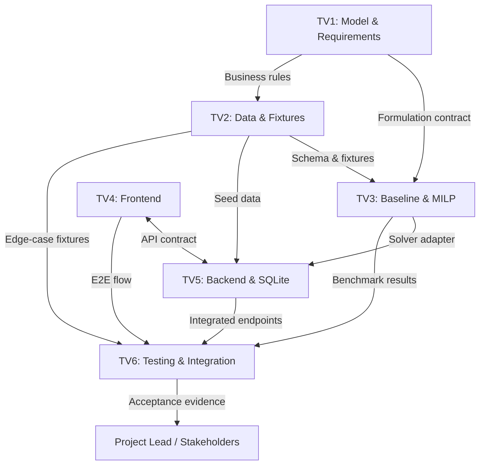

# LogiMind Integration Plan

> **Owner:** TV6 (Integration, Testing & Reporting), coordinated with the Project Lead
> **Last verified:** 2026-11-09
> **Baseline:** `origin/main` at `7424ba4`
> **Rule:** This plan uses only interfaces and schemas already documented in the repository. It does not define or invent mathematical rules, API fields, or module behavior.

---

## 1. Sources of truth

| Concern | Existing document |
| :--- | :--- |
| Business rules, sets, parameters, constraints | [mathematical-model.md](../mathematical-model.md), [requirements.md](../requirements.md) |
| Module boundaries and handoff checklist | [integration-guide.md](../integration-guide.md) |
| Planned components and data flow | [architecture.md](../architecture.md) |
| API endpoints and payloads | [api-contract.md](../api-contract.md) *(Proposed)* |
| Data entities | [data-dictionary.md](../data-dictionary.md) *(Draft; Appendix A covers the legacy prototype)* |
| Test tiers and edge cases | [testing-strategy.md](../testing-strategy.md) |
| Technical decisions | [ADR index](../decisions/README.md) — ADR-001..003 are `PROPOSED` |

If any of these documents conflict, the conflict is a blocker to resolve **before** implementation integration. Known conflicts are listed in [project-status §4](project-status.md#4-blockers-and-dependencies).

---

## 2. Existing module dependency map

Derived from [integration-guide §2](../integration-guide.md):

**Actual implementation status:** only TV1 documents and partial TV2 data exist. TV3, TV4, and TV5 have no implementation in their assigned directories. The legacy `scripts/validate_orders.py` is a standalone prototype, not an integrated module.

---

## 3. Integration sequence and readiness gates

Gates are sequential. A gate opens only when its exit evidence is present in the repository.

| Gate | Entry criteria | Required artifacts | Verification | Exit criteria | Current status |
| :--- | :--- | :--- | :--- | :--- | :--- |
| **G0 — Rules and schema** | TV1 model and TV2 data drafts exist | Approved policy A/B; resolved capacity/SKU/cost/penalty/split decisions; canonical data schema | Project Lead review; TV1/TV2 sign-off; documented decision | Rules are unambiguous and one schema is authoritative | **Blocked** — six conflicts unresolved |
| **G1 — Contracts frozen** | G0 complete | Signed-off `ProblemInput`/`SolutionOutput` contract; API contract revision; status/error enums | TV1/TV3/TV5/TV4 review; example payloads validated | Contracts are versioned and no known mismatch remains | **Blocked** — API/model conflicts and proposed statuses |
| **G2 — Fixtures ready** | G0, G1 complete | Canonical fixtures: feasible, infeasible, tight-resource, tie-break, scale; schema validator | TV2 runs validator; TV6 independently checks schema and edge cases | All fixtures pass validation; expected outcomes documented | **Blocked** — no validator; schemas conflict |
| **G3 — Solver ready** | G1, G2 complete | Baseline, MILP, solver adapter, unit tests, benchmark report | TV3 test run; TV6 independent invariant checks | Solver consumes canonical input and returns contractual output | **Not Started** |
| **G4 — Backend ready** | G3 complete | FastAPI endpoints, SQLite schema/migrations, persistence, timeout handling, contract tests | TV5 tests; TV6 contract tests against fixtures | API matches frozen contract and persists/reloads results | **Not Started** |
| **G5 — Frontend ready** | G1, G4 complete | UI against mock API, then live API; documented start command; E2E flow | TV4 demo; TV6 E2E walkthrough | User can select data, run allocation, and inspect results | **Not Started** |
| **G6 — System acceptance** | G2–G5 complete | Executed test report; benchmark comparison; E2E evidence; known limitations | TV6 full test run in CI; Project Lead review | Acceptance criteria met; evidence bundle archived | **Not Started** |

### Gate policy

- Do not start a downstream gate on assumptions. If a field, status, or unit is undefined, the gate stays blocked.
- A gate may be reopened if an upstream contract changes.
- Document any temporary mock or stub explicitly; mocks do not count as integration evidence.

---

## 4. Required handoff artifacts

These are derived from [integration-guide §3](../integration-guide.md). The provider owns the artifact; the consumer verifies it; TV6 records the evidence.

| From | To | Required artifact | Acceptance evidence |
| :--- | :--- | :--- | :--- |
| **TV1** | TV2, TV3 | Approved model, parameter definitions, policy decision, worked example, status semantics | Approved decision/ADR; example reproduced; handoff checklist completed |
| **TV2** | TV3, TV5, TV6 | Canonical schema, validated fixtures, generator/validator, expected outcomes | Validator output; fixture inventory; schema version |
| **TV3** | TV5, TV6 | Solver adapter, input/output contract, unit tests, benchmark results, timeout/error behavior | Test output; adapter signature; benchmark table |
| **TV5** | TV4, TV6 | API implementation, request/response examples, persistence schema, contract tests | Contract test output; endpoint transcript; DB read-back evidence |
| **TV4** | TV6 | Runnable UI, start instructions, API configuration, E2E walkthrough | Recorded walkthrough/screenshots; E2E test |
| **TV6** | Project Lead | Gate report, traceability matrix, test evidence, risks, acceptance recommendation | Signed gate decision; linked evidence |

### Handoff quality rules

- Every artifact must be versioned or linked to a commit/PR.
- A handoff is incomplete if its consumer cannot run or validate it from the repository alone.
- Do not hand off screenshots or prose as a substitute for executable evidence where execution is required.
- Checklist items in [integration-guide](../integration-guide.md) remain the minimum; this plan does not replace them.

---

## 5. Interface verification checklist

Use this checklist at G1–G5. “Current” reflects the repository on the verification date.

### 5.1 Data contract

- [ ] Field names, types, nullability, and units match one approved schema
- [ ] Capacity unit is defined consistently (orders vs. item units)
- [ ] Per-SKU inventory is present for every warehouse–SKU pair
- [ ] Shipping cost `c_ij` is present/derived by one documented rule
- [ ] Unassigned penalty `P_i` is present with the approved granularity
- [ ] Split-shipment policy is reflected in the schema or explicitly excluded
- [ ] Fixture identifiers, versions, and expected outcomes are documented

**Current:** not verified. `data/samples/benchmark_data.json`, `data/samples/sample_small.json`, and `docs/data-dictionary.md` still describe different schemas. The repository cleanup consolidated the former root dictionary into Appendix A, but reconciling the canonical data contract remains TV2 work. See [project-status §4](project-status.md#4-blockers-and-dependencies).

### 5.2 Solver adapter contract

- [ ] Callable name/signature matches the interface agreed for integration
- [ ] Input validation rejects malformed or missing required data
- [ ] Output includes assignments/unassigned orders, cost components, status, and remaining resources
- [ ] Solution-status vocabulary is agreed and mapped consistently
- [ ] Tie-breaking is deterministic or explicitly documented
- [ ] Timeout and solver-error behavior is defined
- [ ] Solver does not mutate shared input data
- [ ] Runtime measurement scope is documented

**Current:** not implemented. The expected adapter is described in [integration-guide §3.3](../integration-guide.md); no code exists.

### 5.3 API contract

- [ ] Endpoints and methods match the approved contract
- [ ] Success/error envelopes match the approved contract
- [ ] Validation errors, infeasibility, and timeout map to documented HTTP statuses
- [ ] Solver statuses map to API status values without ambiguity
- [ ] Response includes the metrics required by the approved model/requirements
- [ ] Request/response examples are executable against the implementation

**Current:** [api-contract.md](../api-contract.md) is `Proposed`; no backend exists. Split shipments, handling cost, and status names conflict with the model.

### 5.4 Persistence

- [ ] Schema and migrations match the canonical entities
- [ ] Referential integrity is enforced for orders, order lines, warehouses, inventory, and runs
- [ ] Saved runs reload with identical configuration, allocations, and metrics
- [ ] Database files are ignored by Git
- [ ] Migration/seed procedure is documented and reproducible

**Current:** no schema or migration; ADR-003 is `PROPOSED`. `.gitignore` on `origin/main` does not ignore `*.db`/`*.sqlite` despite [ADR-003 line 24](../decisions/0003-choice-of-database-engine.md).

### 5.5 Frontend

- [ ] UI runs in mock mode without a backend
- [ ] UI switches to the live API without code changes beyond configuration
- [ ] Validation, infeasible, timeout, and server-error states are visible
- [ ] Allocation, cost breakdown, utilization, and unassigned/split views use documented fields only
- [ ] E2E flow is documented for TV6

**Current:** no frontend files or package manifest.

### 5.6 Cross-cutting

- [ ] Same input and configuration reproduce the same result (seed/version recorded)
- [ ] No secrets, `.env`, database files, or raw datasets are committed
- [ ] Test evidence includes command, environment, and observed output
- [ ] Documentation status matches implementation status
- [ ] CI runs the tests and is required before merge

**Current:** CI runs hygiene checks only; `.gitignore` regression exists on `main`; no executable tests.

---

## 6. Integration blockers

| Blocker | Effect on integration | Resolution owner | Evidence |
| :--- | :--- | :--- | :--- |
| Business rules unresolved | G0 cannot open; all downstream contracts unstable | TV1 / Project Lead | [project-status B-01](project-status.md#4-blockers-and-dependencies) |
| No canonical schema | Data cannot cross module boundaries | TV2 | project-status B-02 |
| API/model mismatch | Frontend/backend/solver disagree | TV1, TV3, TV4, TV5 | project-status B-03 |
| No solver adapter | Backend cannot invoke optimization | TV3 | project-status B-04 |
| No backend/SQLite | UI and E2E cannot integrate | TV5 | project-status B-05 |
| No frontend | E2E cannot start | TV4 | project-status B-06 |
| No test harness/CI test job | Integration evidence cannot be produced | TV6 | project-status B-07 |
| No task ownership | Blockers are not escalated or evidenced | Project Lead | project-status B-08 |

---

## 7. Current integration readiness

| Module | Ready for integration? | Reason |
| :--- | :--- | :--- |
| TV1 model | **No** | Draft/proposed; policy and six rules unresolved |
| TV2 data | **No** | Partial fixtures; conflicting schemas; no validator |
| TV3 solver | **No** | No implementation or adapter |
| TV5 backend | **No** | No API or database |
| TV4 frontend | **No** | No implementation |
| TV6 test harness | **No** | No executable tests or CI test job |

**Verdict:** No module is integration-ready. The only executable artifact is the standalone root prototype, which does not implement the documented contract and is not part of an assigned module.

---

## 8. Related documents

- [Project Status](project-status.md)
- [Task Tracker](task-tracker.md)
- [Test Plan](test-plan.md)
- [Integration Guide](../integration-guide.md)
- [Architecture](../architecture.md)
- [API Contract](../api-contract.md)
