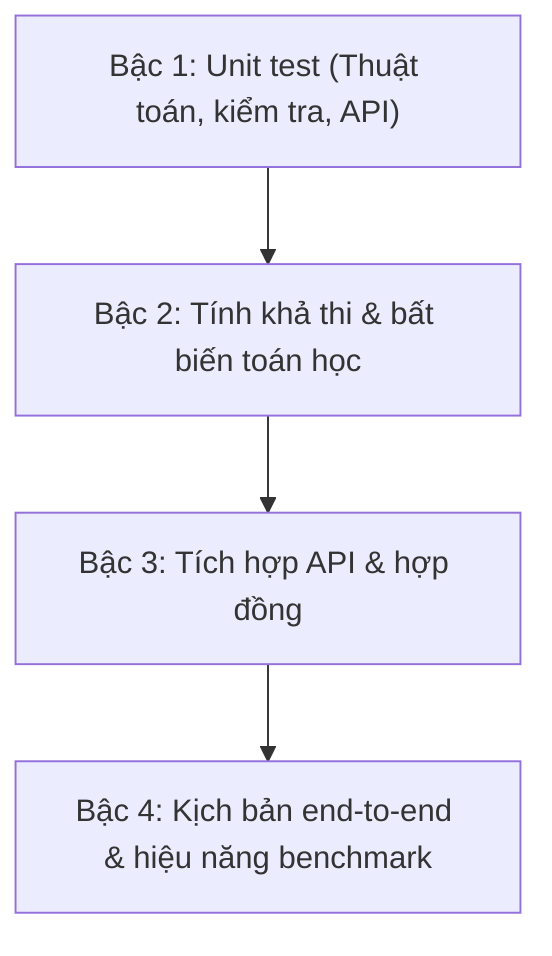

# Chiến lược kiểm thử: LogiMind

> **Chủ sở hữu chính:** TV6 (Tích hợp, Kiểm thử & Báo cáo)
> **Vai trò hỗ trợ:** TV1, TV2, TV3, TV4, TV5
> **Trạng thái:** Tài liệu chiến lược đang hiệu lực — đã căn chỉnh Policy A

---

## 1. Triết lý kiểm thử

Hệ thống tối ưu cần đồng thời **tính đúng đắn của phần mềm** và **tính hợp lệ của toán học**. Một kết quả không được chấp nhận nếu vi phạm ràng buộc thực tế hoặc báo sai tính khả thi. Dưới Policy A, một phương án hợp lệ phải thỏa mọi ràng buộc bên dưới; một bộ dữ liệu hợp lệ về cấu trúc vẫn có thể không khả thi về mặt toán học.

**Hợp lệ không đồng nghĩa với khả thi.** Không coi một instance không khả thi là dữ liệu không hợp lệ, và không báo `INFEASIBLE` chỉ vì quá trình tìm kiếm hết thời gian.

---

## 2. Các bất biến của Policy A

Với mọi đơn $i$, kho $j$ và SKU $k$:

1. **Đúng một kho cho mỗi đơn**
   $$\sum_{j \in J} x_{ij} = 1 \quad \forall i \in I$$
2. **Không tách đơn và không có đơn chưa gán** — không có gán phân số hoặc gán nhiều kho; không có biến $u_i$ và không có thành phần penalty.
3. **Tồn kho theo từng SKU**
   $$\sum_{i \in I} q_{ik} x_{ij} \le s_{jk} \quad \forall j \in J,\ k \in K$$
4. **Công suất theo số đơn**
   $$\sum_{i \in I} x_{ij} \le C_j \quad \forall j \in J$$
   trong đó $C_j$ là `capacity_orders`, không phải số đơn vị sản phẩm.
5. **Tuyến khả dụng** — $x_{ij}=0$ khi kho $j$ không có trong `shipping_costs` của đơn $i$.
6. **Hàm mục tiêu** — tính lại tổng chi phí vận chuyển từ bộ dữ liệu gốc và so sánh với `shipping_cost` / `objective_value`. Không có handling cost hoặc thành phần penalty.

Phần cài đặt phải tính lại các bất biến này từ bộ dữ liệu gốc, không tin tưởng các trường tổng hợp do bộ giải trả về.

---

## 3. Các bậc kiểm thử



### Bậc 1: Unit test (TV2, TV3, TV5)

- Kiểm tra bộ dữ liệu chuẩn, tính tất định của generator, toàn vẹn ngữ nghĩa.
- Thứ tự và quy tắc phá hòa của heuristic baseline.
- Kiểm tra request/Pydantic theo schema chuẩn.

### Bậc 2: Tính khả thi & bất biến toán học (TV1, TV3, TV6)

- Kiểm chứng mọi bất biến trong §2 trên bộ dữ liệu gốc.
- Chỉ xác nhận `INFEASIBLE` khi có chứng minh; xác nhận `NO_SOLUTION_FOUND` khi timeout mà không có chứng minh.
- Xác nhận chi phí MILP không tệ hơn baseline khả thi trên các fixture benchmark.

### Bậc 3: Test tích hợp API (TV5, TV6)

- Ánh xạ HTTP: `200` cho `OPTIMAL`/`FEASIBLE`/`NO_SOLUTION_FOUND`, `400` cho lỗi kiểm tra, `422` cho `INFEASIBLE` đã chứng minh, `500` cho `ERROR`.
- `dataset` trong request hợp lệ theo schema chuẩn; không chấp nhận trường split/penalty.
- Phản hồi có một `warehouse_id` cho mỗi đơn và mức sử dụng theo số đơn.

### Bậc 4: End-to-end (TV4, TV6)

- Chọn bộ dữ liệu → chạy phân bổ → hiển thị một kho cho mỗi đơn, chi phí vận chuyển và mức sử dụng công suất.
- Không có giao diện giao tách đơn hoặc penalty xử lý.
- Kết quả không khả thi và timeout được hiển thị khác nhau.

---

## 4. Edge case bắt buộc

| Mã | Tình huống | Kết quả mong đợi |
| :--- | :--- | :--- |
| **EDGE-01** | Hết hàng toàn hệ thống: cầu một SKU vượt tổng tồn kho. | Chỉ `INFEASIBLE` khi có chứng minh; nếu tìm kiếm dừng thì `NO_SOLUTION_FOUND`. Không bao giờ là lỗi kiểm tra. |
| **EDGE-02** | Kho gần nhất còn hàng nhưng hết công suất. | Đơn được gán cho kho khác đủ điều kiện; không vượt công suất. |
| **EDGE-03** | Công suất và tồn kho cùng căng: chỉ một phương án đầy đủ cụ thể hoạt động. | Bộ giải tìm ra phương án hoặc chứng minh `INFEASIBLE`; không tách đơn và không bỏ đơn. |
| **EDGE-04** | Đơn rỗng (`items = {}`) hoặc số lượng không dương. | Kiểm tra đầu vào từ chối với `VALIDATION_ERROR` / HTTP `400`. |
| **EDGE-05** | Hai kho có chi phí vận chuyển giống nhau. | Baseline phá hòa tất định; MILP có thể trả bất kỳ phương án tối ưu nào. |
| **EDGE-06** | Một tuyến bị bỏ khỏi `shipping_costs`. | Kho bị bỏ không bao giờ được dùng cho đơn đó. |
| **EDGE-07** | Chỉ một kho có tuyến và đủ tồn kho/công suất. | Đơn buộc phải gán cho kho đó. |
| **EDGE-08** | Bộ giải chạm `time_limit_seconds` mà chưa có phương án đầy đủ. | `NO_SOLUTION_FOUND`, không phải `INFEASIBLE`. |
| **EDGE-09** | Bộ giải chạm `time_limit_seconds` sau khi đã tìm được phương án đầy đủ. | `FEASIBLE` với phân bổ đầy đủ; không tuyên bố tối ưu. |
| **EDGE-10** | Bộ dữ liệu hợp lệ về cấu trúc nhưng không khả thi về toán học. | `INFEASIBLE`; bộ dữ liệu vẫn hợp lệ. |

Không có test đánh đổi giao tách đơn dưới Policy A. Hành vi riêng của split được cố ý đặt ngoài phạm vi.

---

## 5. Ngữ nghĩa trạng thái cần kiểm thử

| Trạng thái | Minh chứng bắt buộc |
| :--- | :--- |
| `OPTIMAL` | Phân bổ đầy đủ hợp lệ và chứng chỉ/trạng thái tối ưu đã được chứng minh. |
| `FEASIBLE` | Phân bổ đầy đủ hợp lệ; chưa chứng minh tối ưu (ví dụ do giới hạn thời gian). |
| `INFEASIBLE` | Chứng minh từ tìm kiếm vét cạn hoặc chứng chỉ bất khả thi của bộ giải. |
| `NO_SOLUTION_FOUND` | Tìm kiếm dừng khi chưa có phương án đầy đủ và chưa có chứng minh. |
| `ERROR` | Đầu vào không hợp lệ hoặc lỗi thực thi ngoài dự kiến. |

Test không bao giờ được chấp nhận `UNKNOWN`/`NO_SOLUTION_FOUND` như `INFEASIBLE`.

---

## 6. Hướng dẫn thực thi

Các kiểm tra đã triển khai (TV2):

```bash
python scripts/validate_dataset.py data/samples/
python -m unittest discover -s tests -v
python -m pytest tests/ -v
python scripts/check_feasibility.py data/samples/sample_small.json --json
```

Trạng thái TV2 kỳ vọng: 10 fixture chuẩn hợp lệ với 0 lỗi; 60 test pass. Bộ kiểm chứng khả thi là vét cạn cho bài toán nhỏ và trả `FEASIBLE`, `INFEASIBLE`, `UNKNOWN` hoặc `INVALID`.

Các kiểm tra dự kiến (TV3/TV5/TV6): bộ unit/integration/E2E trong `tests/unit/`, `tests/integration/` và `tests/e2e/`, cùng test hợp đồng API cho ánh xạ trạng thái tại [api-contract.md](api-contract.md) §5.

> Test tích hợp, bộ giải và API chưa tồn tại. Không báo chúng pass cho đến khi module sở hữu được triển khai.
