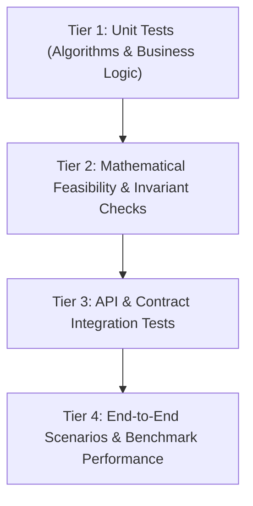

# Testing Strategy: LogiMind

> **Primary Owner:** TV6 (Integration, Testing & Reporting)  
> **Supporting Roles:** TV1, TV2, TV3, TV4, TV5  
> **Status:** Active Strategy Document

---

## 1. Testing Philosophy

In optimization systems, testing extends beyond software execution correctness to **mathematical validity** and **feasibility preservation**. A solution is unacceptable if it generates an error or violates physical operational constraints (e.g. over-drawing inventory, exceeding daily warehouse capacity).

Every pull request must maintain 100% adherence to all mathematical constraints.

---

## 2. Test Tiers



### Tier 1: Unit Tests (TV3 & TV5)
- **Scope:** Individual functions, data transformations, heuristic assignment rules, and Pydantic request validators.
- **Tools:** `pytest`.
- **Target:** Fast execution (< 5 seconds), 0 external network dependencies.

### Tier 2: Mathematical Feasibility & Invariants (TV1, TV3, TV6)
- **Scope:** Asserting that solver outputs strictly satisfy:
  1. $\sum_j x_{i,j,k} \le I_{j,k}$ (Never allocate more than available stock).
  2. $\sum_{i,k} x_{i,j,k} \le C_j$ (Never exceed warehouse throughput limits).
  3. $\sum_j x_{i,j,k} = D_{i,k}$ (All demand satisfied, or flagged in slack).
  4. Optimality assertion: $\text{Cost}(MILP) \le \text{Cost}(Baseline)$ for all benchmark sets.

### Tier 3: API Integration Tests (TV5 & TV6)
- **Scope:** HTTP status codes, schema validation, database persistence, timeout recovery, and structured error responses.
- **Endpoints Tested:** `/api/v1/health`, `/api/v1/allocations/run`, `/api/v1/allocations/compare`.

### Tier 4: End-to-End (E2E) & Demo Scenarios (TV4 & TV6)
- **Scope:** User flow from selecting benchmark data $\to$ triggering solver $\to$ rendering cost comparison graph $\to$ inspecting split shipment breakdown.

---

## 3. Mandatory Edge Cases to Test

| Edge Case ID | Scenario | Expected Outcome |
| :--- | :--- | :--- |
| **EDGE-01** | **Global Stock Out:** Total demand for SKU-A exceeds network-wide inventory. | Solver reports infeasibility or logs exact unfulfilled slack with penalty. |
| **EDGE-02** | **Warehouse Bottleneck:** Nearest warehouse has stock but 0 capacity left. | Order is diverted to secondary warehouse with capacity. |
| **EDGE-03** | **Split Shipment Trade-off:** High split penalty outweighs distance savings. | Solver chooses a single distant warehouse over splitting between 2 nearby hubs. |
| **EDGE-04** | **Zero Demand Order:** Order submitted with 0 items. | Input validation rejects with HTTP 400. |
| **EDGE-05** | **Tie Breaking:** Two warehouses have identical cost and capacity. | Deterministic allocation produced across multiple runs. |

---

## 4. Test Execution Guidelines

Once Python dependencies are installed in Phase 2:
```bash
# Run all unit and validation tests
pytest tests/ -v

# Run only optimization feasibility tests
pytest tests/test_optimization.py -k "invariant"
```
*(Currently pending implementation of test files).*
