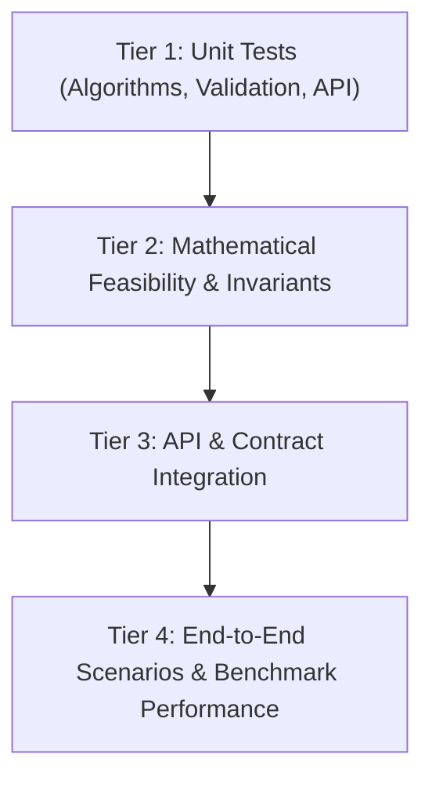

# Testing Strategy: LogiMind

> **Primary Owner:** TV6 (Integration, Testing & Reporting)
> **Supporting Roles:** TV1, TV2, TV3, TV4, TV5
> **Status:** Active Strategy Document — Policy A aligned

---

## 1. Testing Philosophy

Optimization systems require both **software correctness** and **mathematical
validity**. A result is unacceptable if it violates physical constraints or
misreports feasibility. Under Policy A, a valid allocation must satisfy every
constraint below; a structurally valid dataset may still be mathematically
infeasible.

**Validity is not feasibility.** Do not treat an infeasible instance as invalid
data, and do not report `INFEASIBLE` merely because a search timed out.

---

## 2. Policy A invariants

For every order $i$, warehouse $j$, and SKU $k$:

1. **Exactly one warehouse per order**
   $$\sum_{j \in J} x_{ij} = 1 \quad \forall i \in I$$
2. **No split and no unassigned order** — no fractional or multi-warehouse
   assignment; there is no $u_i$ variable and no penalty term.
3. **Per-SKU inventory**
   $$\sum_{i \in I} q_{ik} x_{ij} \le s_{jk} \quad \forall j \in J,\ k \in K$$
4. **Order-count capacity**
   $$\sum_{i \in I} x_{ij} \le C_j \quad \forall j \in J$$
   where $C_j$ is `capacity_orders`, not item units.
5. **Route availability** — $x_{ij}=0$ when warehouse $j$ is omitted from
   order $i$'s `shipping_costs`.
6. **Objective** — recompute total shipping cost from the original dataset and
   compare it with `shipping_cost` / `objective_value`. There is no handling cost
   or penalty component.

An implementation must recompute these invariants from the original dataset, not
trust the solver's summary fields.

---

## 3. Test tiers



### Tier 1: Unit Tests (TV2, TV3, TV5)

- Canonical dataset validation, generator determinism, semantic integrity.
- Baseline heuristic ordering and tie-breaking.
- Pydantic/request validation against the canonical schema.

### Tier 2: Mathematical Feasibility & Invariants (TV1, TV3, TV6)

- Assert every invariant in §2 against the original dataset.
- Verify `INFEASIBLE` only with a proof; verify `NO_SOLUTION_FOUND` on a timeout
  without proof.
- Verify MILP cost is not worse than a feasible baseline on benchmark fixtures.

### Tier 3: API Integration Tests (TV5, TV6)

- HTTP status mapping: `200` for `OPTIMAL`/`FEASIBLE`/`NO_SOLUTION_FOUND`, `400`
  for validation errors, `422` for proven `INFEASIBLE`, `500` for `ERROR`.
- Request `dataset` validates against the canonical schema; no split/penalty
  fields accepted.
- Response contains one `warehouse_id` per order and order-count utilization.

### Tier 4: End-to-End (TV4, TV6)

- Select dataset → run allocation → display one warehouse per order, shipping
  cost, and capacity utilization.
- No split-shipment or handling-penalty views.
- Infeasible and timeout results are shown distinctly.

---

## 4. Mandatory edge cases

| ID | Scenario | Expected Outcome |
| :--- | :--- | :--- |
| **EDGE-01** | Global stock-out: demand for a SKU exceeds network inventory. | `INFEASIBLE` only with a proof; otherwise `NO_SOLUTION_FOUND` if search stopped. Never a validation error. |
| **EDGE-02** | Nearest warehouse has stock but zero remaining capacity. | Order is assigned to another eligible warehouse; capacity is not exceeded. |
| **EDGE-03** | Tight combined capacity and inventory: only a specific complete assignment works. | Solver finds the assignment or proves `INFEASIBLE`; no split or unassigned fallback. |
| **EDGE-04** | Empty order (`items = {}`) or non-positive quantity. | Input validation rejects with `VALIDATION_ERROR` / HTTP `400`. |
| **EDGE-05** | Two warehouses have identical shipping cost. | Baseline breaks ties deterministically; MILP may return any optimal allocation. |
| **EDGE-06** | A route is omitted from `shipping_costs`. | The omitted warehouse is never used for that order. |
| **EDGE-07** | Only one warehouse has a route and enough stock/capacity. | Order is forced to that warehouse. |
| **EDGE-08** | Solver reaches `time_limit_seconds` with no complete solution. | `NO_SOLUTION_FOUND`, not `INFEASIBLE`. |
| **EDGE-09** | Solver reaches `time_limit_seconds` after finding a complete solution. | `FEASIBLE` with complete allocations; optimality not claimed. |
| **EDGE-10** | Structurally valid dataset that is mathematically infeasible. | `INFEASIBLE`; dataset remains valid. |

No split-shipment trade-off test exists under Policy A. Split-specific behavior
is intentionally out of scope.

---

## 5. Status semantics to test

| Status | Required evidence |
| :--- | :--- |
| `OPTIMAL` | Complete valid allocation and a proven optimality certificate/solver status. |
| `FEASIBLE` | Complete valid allocation; optimality not proven (e.g. time limit). |
| `INFEASIBLE` | Proof from exhaustive search or solver infeasibility certificate. |
| `NO_SOLUTION_FOUND` | Search stopped without a complete solution and without proof. |
| `ERROR` | Invalid input or unexpected execution failure. |

Tests must never accept `UNKNOWN`/`NO_SOLUTION_FOUND` as `INFEASIBLE`.

---

## 6. Execution guidelines

Current implemented checks (TV2):

```bash
python scripts/validate_dataset.py data/samples/
python -m unittest discover -s tests -v
python -m pytest tests/ -v
python scripts/check_feasibility.py data/samples/sample_small.json --json
```

Expected TV2 state: 10 canonical fixtures validate with 0 errors; 60 tests pass.
The feasibility oracle is exhaustive for small instances and returns
`FEASIBLE`, `INFEASIBLE`, `UNKNOWN`, or `INVALID`.

Planned checks (TV3/TV5/TV6): unit/integration/E2E suites under
`tests/unit/`, `tests/integration/`, and `tests/e2e/`, plus API contract tests
for the status mapping in [api-contract.md](api-contract.md) §5.

> Integration, solver, and API tests do not exist yet. Do not report them as
> passing until the owning modules are implemented.
